<p align="center">
  
</p>

<h1 align="center">Edita</h1>

<p align="center">
  <a href="README.md"><b>English</b></a> &nbsp;|&nbsp; <b>Español</b>
</p>

<p align="center">
  <b>Un editor al estilo de Notepad++, hecho para Linux.</b><br>
  Un editor de texto y código nativo, con Qt 6, con el motor de edición, los archivos de configuración y la API de plugins de Notepad++,<br>
  y las herramientas que hoy se esperan: LSP, Git, una terminal integrada y las tareas del proyecto.
</p>

<p align="center">
  <a href="https://github.com/alktrip/edita/releases/latest"></a>
  <a href="https://github.com/alktrip/edita/actions/workflows/linux.yml"></a>
  <a href="COPYING"></a>
  
</p>

<p align="center">
  <a href="https://alktrip.github.io/edita/es/"><b>Sitio web</b></a> &nbsp;·&nbsp;
  <a href="#instalar"><b>Instalar</b></a> &nbsp;·&nbsp;
  <a href="https://github.com/alktrip/edita/releases"><b>Versiones</b></a> &nbsp;·&nbsp;
  <a href="data/manual/es"><b>Manual</b></a> &nbsp;·&nbsp;
  <a href="docs/plugins.md"><b>SDK de plugins</b></a> &nbsp;·&nbsp;
  <a href="https://github.com/alktrip/edita/issues/new/choose"><b>Reportar un problema</b></a> &nbsp;·&nbsp;
  <a href="README.md">English</a>
</p>

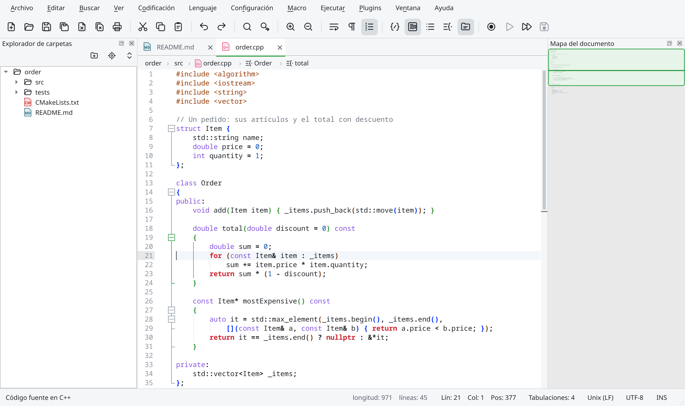

> [!NOTE]
> **Edita es un proyecto independiente, derivado de Notepad++ bajo la GPL v3 de GNU. No está afiliado a Don Ho ni al proyecto Notepad++, ni cuenta con su aval.** Descarga la [última versión](https://github.com/alktrip/edita/releases/latest) y [cuéntanos qué encuentras](https://github.com/alktrip/edita/issues/new/choose).

---

## Por qué Edita

Notepad++ es uno de los editores más queridos en Windows, y solo funciona en Windows. Quien se pasa a Linux pierde la forma de trabajar que conoce: sus menús y atajos, su búsqueda, sus macros, sus temas y sus plugins.

**Edita es un editor nativo para Linux que conserva esa forma de trabajar.** Usa el mismo motor de edición que Notepad++ (Scintilla y Lexilla), lee los mismos archivos de configuración y habla la misma API de plugins. Además, añade lo que se espera de un editor moderno.

**Más que un editor de texto, menos que un IDE.** Edita tiene servidores de lenguaje, Git, una terminal y las tareas del proyecto, pero sigue siendo un editor de archivos y carpetas: no hay un proyecto que configurar, ni depurador, ni un sistema de compilación propio (ejecuta el tuyo: Make, CMake, npm, Cargo…), ni más refactorización que la que ofrece el servidor de lenguaje. Abre en una fracción de segundo y funciona igual con un archivo que con un repositorio entero. Si necesitas un depurador o herramientas de proyecto a fondo, un IDE es mejor opción.

| Si… | Edita te da… |
|---|---|
| **Vienes de Notepad++** | Los mismos menús, atajos, modos de búsqueda, macros, sesiones, temas y archivos `langs.xml` / `stylers.xml` / `shortcuts.xml`. |
| **Programas en Linux** | Un editor nativo y rápido con LSP, Git, terminal, tareas del proyecto y comparar archivos, para cuando un IDE es más de lo que necesitas. |
| **Escribes plugins** | Una API en C documentada, compatible con los mensajes de Notepad++, un SDK y herramientas para portar plugins de Notepad++. |

---

## Funciones

<table>
<tr>
<td width="50%" valign="top">

### Lo de Notepad++
- Pestañas, dos vistas y clones, sesiones con nombre y la sesión como la dejaste
- Detecta la codificación y el fin de línea como Notepad++, más de 40 juegos de caracteres
- Buscar y reemplazar: normal, extendido y expresiones regulares de Boost, en archivos y carpetas, con Marcar y marcadores
- Macros, editor de columnas, edición múltiple, ocultar líneas, plegado
- Mapa del documento, lista de funciones, Carpeta como espacio de trabajo, historial del portapapeles
- Lenguajes definidos por el usuario, Configurador de estilos y 30 temas, todo en los formatos de Notepad++
- Menú Ejecutar, asignación de atajos, autocompletado con los archivos de API de Notepad++, imprimir y exportar a PDF
- 95 lenguajes coloreados de serie

</td>
<td width="50%" valign="top">

### Herramientas para programar
- **Servidores de lenguaje (LSP):** diagnósticos, autocompletado, información al pasar el ratón, ayuda de firmas, ir a la definición, referencias, renombrar, formatear, acciones de código, símbolos del proyecto y pistas en línea
- **Git:** los cambios en el margen, deshacer o preparar un solo bloque, un panel de commit con el historial del repositorio o del archivo, blame y el estado en el explorador de archivos
- **Terminal integrada** con pestañas (libvterm)
- **Tareas del proyecto:** Make, CMake, npm/pnpm/yarn/bun, Cargo, Go, pytest, Meson y just, con los errores enlazados
- **Paleta de órdenes**, ir a un archivo e ir a un símbolo
- **Comparar** dos archivos, o un archivo con su versión guardada o de Git
- **Historial local** de cada versión guardada
- **CSV, JSON y YAML:** columnas de CSV de colores, alinear y ordenar por columna; validar, formatear y convertir JSON y YAML, y copiar la ruta del cursor
- **Panel TODO** del documento o de todo el proyecto, y un **filtro** en Carpeta como espacio de trabajo
- **Detector de secretos:** las claves de API, los tokens y las contraseñas se subrayan al escribir, y un commit que contiene una pregunta antes
- Fragmentos (formato de VS Code), probador de expresiones regulares, corrector ortográfico (Hunspell), formateadores externos, ruta de navegación, encabezado fijo; los paneles recuerdan dónde los pusiste, y F1 abre el apartado del manual del diálogo actual

</td>
</tr>
</table>

Edita está escrito en C++20 sobre **Qt 6**, con **Scintilla 5** y **Lexilla** como motor de edición. Incluye un [manual de usuario](data/manual/es) (F1), y su interfaz está en español e inglés.

---

## Plugins: el ecosistema de Notepad++, en Linux

Los plugins son lo que hace de Notepad++ algo más que un editor, así que Edita se diseñó en torno a ellos.

**Por qué no se pueden cargar los plugins de Windows tal cual.** Un plugin de Notepad++ es una DLL de Windows que llama a la API Win32. Linux no puede cargarla, así que Edita no promete compatibilidad binaria. Lo que ofrece es **compatibilidad de API**: las mismas funciones exportadas, los mismos mensajes `NPPM_*` y notificaciones `NPPN_*`, y las mismas entradas de menú `FuncItem`. Así, el código fuente de un plugin se puede compilar para Linux.

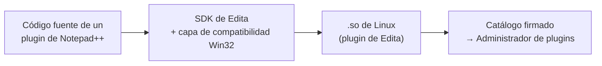

- **API de plugins.** [`edita_plugin.h`](plugin-sdk/edita_plugin.h) refleja la interfaz de plugins de Notepad++ para Linux: cadenas en UTF-8, `NPPM_*`/`NPPN_*` con los mismos números, paneles acoplables, mensajes entre plugins y acceso a Scintilla. Es **estable para toda la serie 1.x**: un plugin compilado para la 1.0 sigue funcionando en cualquier 1.x ([qué se garantiza](docs/plugins.md#qué-no-cambia-en-edita-1x)).
- **Herramientas para portar.** Una capa de compatibilidad con Win32 (ventanas, diálogos de archivos `.rc`, controles comunes, dibujo GDI sobre Qt) y *recetas* que compilan un plugin de Notepad++ desde su código original con algunos parches. `edita --build-recipe` y `edita --check-plugin` los compilan y prueban sin interfaz.
- **Catálogo firmado.** [edita-plugins](https://github.com/alktrip/edita-plugins) compila las recetas en su CI y publica una lista firmada con Ed25519. **Plugins › Administrador de plugins** instala desde él con un clic. Hoy tiene **22 plugins de Notepad++** (XML Tools, JSON Viewer, MIME Tools, Npp Converter, un formateador de SQL, lexers de lenguajes…) y **FTP y SFTP**, la versión propia de Edita de NppFTP: explora servidores por SFTP, FTP, FTPES o FTPS, abre sus archivos y súbelos al guardar. Los plugins vienen compilados para x86_64 y arm64.
- **Plugins incluidos.** **Python Script**, con la API del plugin de Notepad++ (muchos scripts funcionan sin cambios); **MarkdownViewer++**, una vista previa de Markdown al momento; un **editor hexadecimal** que trabaja con los bytes de cualquier archivo; y el **detector de secretos**, propio de Edita: subraya las claves de API, los tokens y las contraseñas de tus archivos y avisa antes de un commit que contenga una.

**Escribir un plugin:** empieza por la [guía de plugins](docs/plugins.md) y el [plugin de ejemplo](plugins/EditaDemo). **Portar uno:** añade una receta a [edita-plugins](https://github.com/alktrip/edita-plugins) con un pull request, y la CI del catálogo lo compila, lo prueba y lo publica.

---

## Capturas

<table>
<tr>
<td width="50%">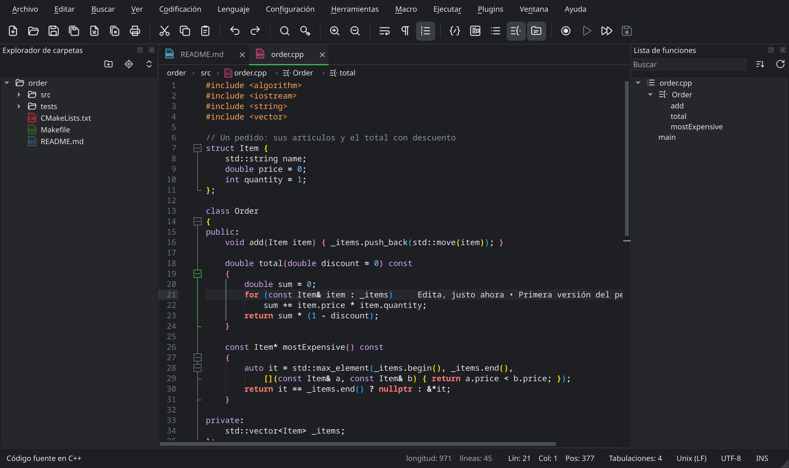</td>
<td width="50%">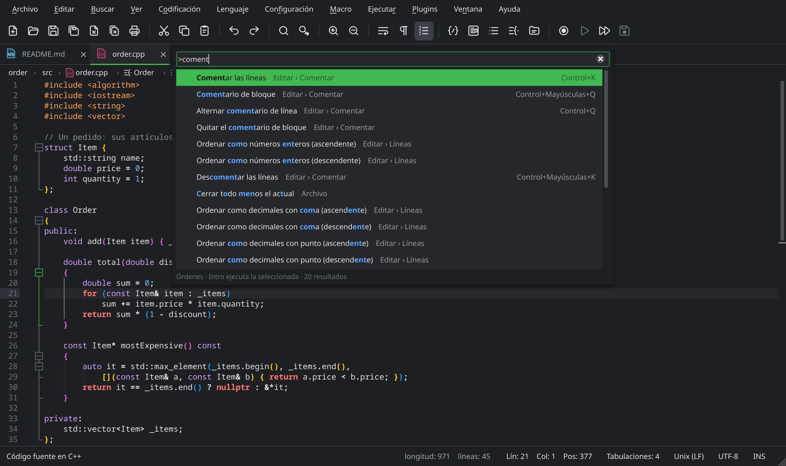</td>
</tr>
<tr>
<td align="center"><b>Tema oscuro</b> con el explorador de archivos y la lista de funciones</td>
<td align="center"><b>Paleta de órdenes</b> (Ctrl+Mayús+A): cualquier orden por su nombre</td>
</tr>
<tr>
<td width="50%">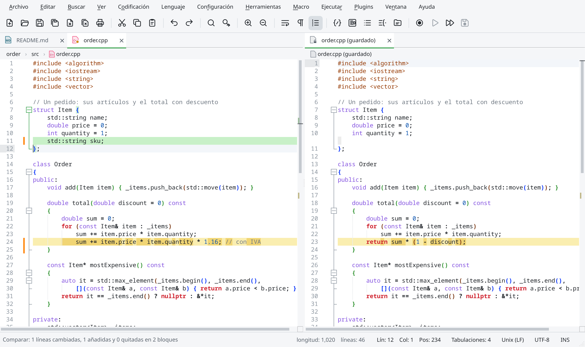</td>
<td width="50%">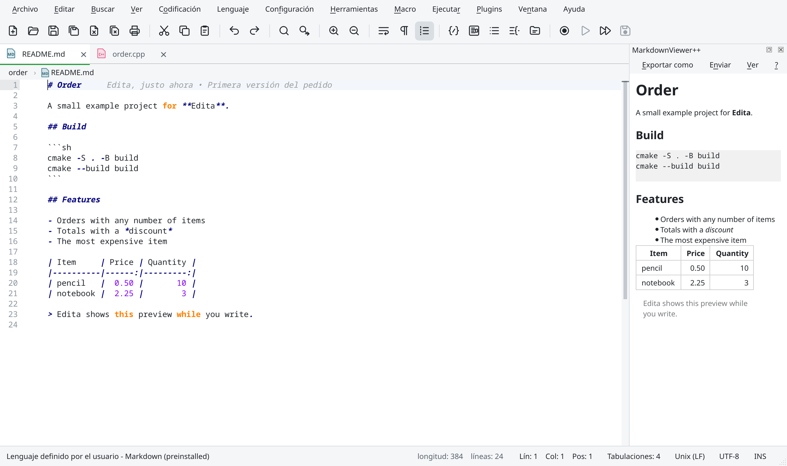</td>
</tr>
<tr>
<td align="center"><b>Comparar</b> con la versión guardada, con Git o con otro archivo</td>
<td align="center"><b>Vista previa de Markdown</b> mientras escribes (MarkdownViewer++)</td>
</tr>
<tr>
<td width="50%">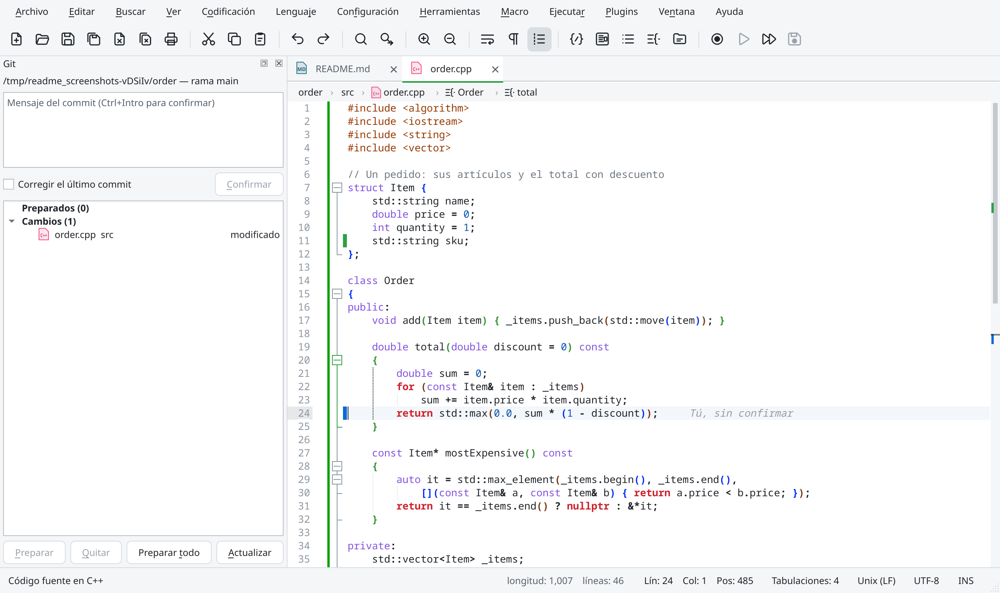</td>
<td width="50%">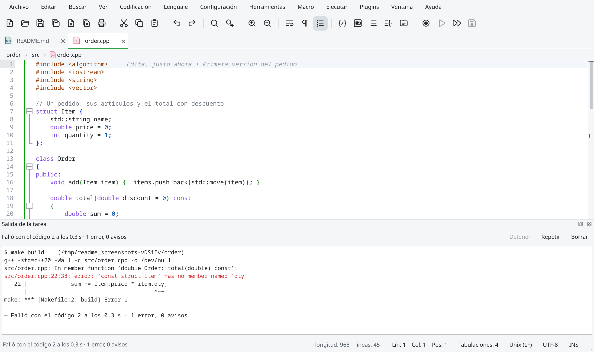</td>
</tr>
<tr>
<td align="center"><b>Git</b>: los cambios en el margen, blame en línea y el panel de commit</td>
<td align="center"><b>Tareas del proyecto</b> (Ctrl+Mayús+B): errores del compilador a un doble clic</td>
</tr>
<tr>
<td width="50%">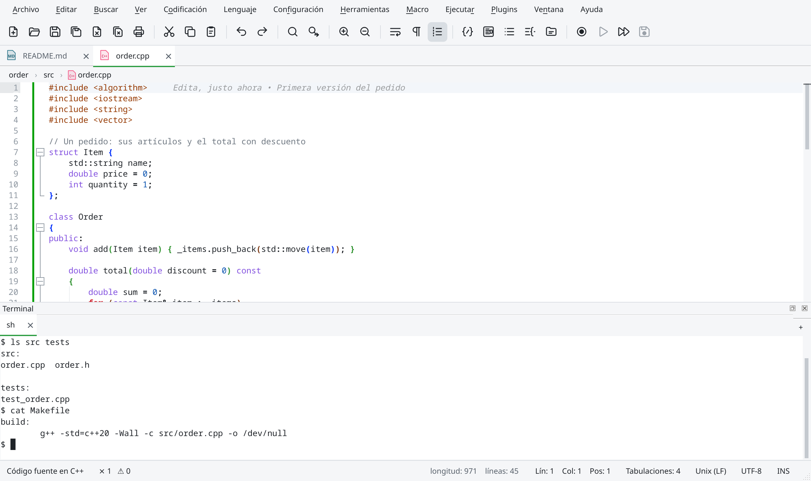</td>
<td width="50%">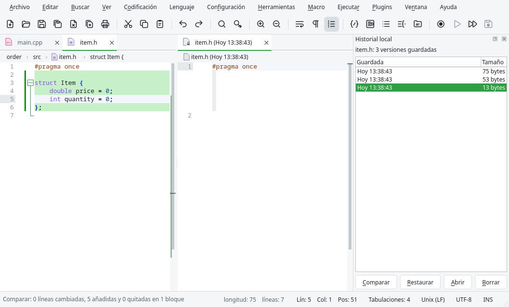</td>
</tr>
<tr>
<td align="center"><b>Terminal integrada</b> (Ctrl+`), con pestañas</td>
<td align="center"><b>Historial local</b>: cada versión guardada, lista para comparar o restaurar</td>
</tr>
</table>

<p align="center">
  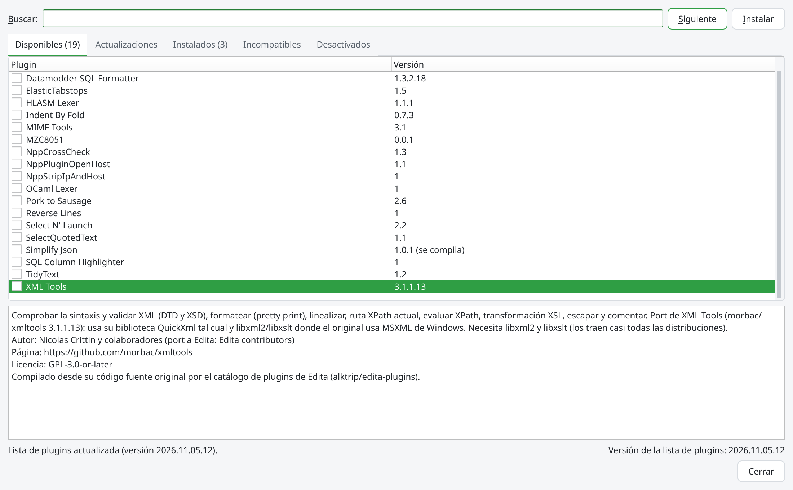<br>
  <b>Administrador de plugins</b> con el catálogo firmado de plugins de Notepad++ compilados para Linux
</p>

Las capturas de esta página muestran la interfaz en español; las del [README en inglés](README.md), en inglés.

---

## Instalar

Cada [versión](https://github.com/alktrip/edita/releases/latest) trae un AppImage, un `.deb` y un `.rpm` para **x86_64** y **arm64** (aarch64). `uname -m` dice cuál usa tu equipo. Todos incluyen su propio Qt, Python Script y MarkdownViewer++.

| Distribución | Paquete | Instalar |
|---|---|---|
| **Debian, Ubuntu, Linux Mint** | `edita_<versión>_amd64.deb` / `_arm64.deb` | `sudo apt install ./edita_*.deb` |
| **Fedora, openSUSE** y compatibles | `edita-<versión>-1.x86_64.rpm` / `.aarch64.rpm` | `sudo dnf install ./edita-*.rpm`<br>`sudo zypper install ./edita-*.rpm` |
| **Cualquier distribución** | `Edita-<versión>-x86_64.AppImage` / `-aarch64.AppImage` | `chmod +x Edita-*.AppImage && ./Edita-*.AppImage` |
| **Arch Linux** | [`packaging/aur/PKGBUILD`](packaging/aur/) (compila con el Qt de Arch) | `makepkg -si` en esa carpeta |
| **Flatpak** | pronto en Flathub; mientras tanto, [`packaging/flatpak`](packaging/flatpak/) lo compila | `packaging/flatpak/build.sh` |

**Requisitos.** En x86_64: Ubuntu 22.04 o más nuevo, Debian 12, Fedora 36 y posteriores, openSUSE Tumbleweed y, en general, cualquier distribución con glibc 2.35 o más nueva. En arm64: Ubuntu 24.04, Debian 13, Raspberry Pi OS 13 (trixie), Fedora 40 o más nuevos (glibc 2.39). Funciona con Wayland y con X11.

Los paquetes añaden Edita al menú de aplicaciones y a **Abrir con**. Para que Edita sea la aplicación predeterminada de algunos tipos de archivo, usa **Configuración › Preferencias › Asociación de archivos**. Edita avisa cuando hay una versión nueva. El `PKGBUILD` de Arch aún no está publicado en AUR.

**Línea de órdenes:**

```sh
edita [archivos…] [-n línea] [-c columna] [-l lenguaje] [--nosession] [--multiInst] [--openSession archivo]
```

La configuración está en `~/.config/edita/`, con los mismos archivos que Notepad++ (`config.xml`, `langs.xml`, `stylers.xml`, `shortcuts.xml`, `session.xml`, `themes/`, `userDefineLangs/`, `plugins/`…), así que puedes traer tu configuración de Notepad++.

---

## Estado del proyecto

| | |
|---|---|
| **Versión actual** | La [última versión](https://github.com/alktrip/edita/releases/latest); sus notas dicen qué cambió |
| **Próximo paso** | Ver el [plan](ROADMAP.md), que dice también cuándo la 1.0 se considera lista |
| **Plataformas** | Linux x86_64 y arm64. macOS, después de la 1.0 para Linux |
| **Paridad con Notepad++** | Casi todas las órdenes de Notepad++ están hechas. Lo que falta (texto de derecha a izquierda y paneles de proyecto) está en [docs/paridad-npp.md](docs/paridad-npp.md) |
| **Calidad** | Más de 80 conjuntos de pruebas automáticas, en la CI para x86_64 y arm64; los paquetes se instalan en Fedora y Debian en la CI antes de cada versión |

**Notas de cada versión:** [GitHub Releases](https://github.com/alktrip/edita/releases) (en español e inglés) · **Historial del desarrollo:** [docs/historial.md](docs/historial.md), una entrada por fase.

---

## Cómo se compara Edita

Varios proyectos llevan Notepad++, o algo parecido, a Linux. Cada uno es bueno en algo distinto:

| | Edita | Notepad++ | Nextpad++ | Notepad Next | CudaText | Kate | VS Code |
|---|---|---|---|---|---|---|---|
| **Qué es** | Derivado de Notepad++, rehecho para Linux | El original | Port de Notepad++ | Reimplementación de Notepad++ | Editor independiente | Editor independiente | Editor independiente |
| **Plataformas** | Linux | Windows | Linux, macOS, iOS | Linux, Windows, macOS | Linux, Windows, macOS | Linux, Windows, macOS | Linux, Windows, macOS |
| **Interfaz** | Qt 6 | Win32 | GTK 4 (Linux), Cocoa (macOS) | Qt 6 | Lazarus / Free Pascal | Qt / KDE Frameworks | Electron |
| **Plugins de Notepad++** | Portados desde su código con un SDK de API compatible; catálogo firmado | DLL nativas | Portados uno a uno; catálogo propio | — | — | — | — |
| **Extensiones** | Plugins de Notepad++, Python Script | Lista grande de plugins | Su catálogo de plugins portados | — | Complementos en Python | Plugins de KDE | Un mercado enorme |
| **Licencia** | GPL-3.0 | GPL-3.0 | GPL-3.0 | GPL-3.0 | MPL-2.0 | LGPL | MIT (código fuente) |

- **Edita**: la forma de trabajar de Notepad++ y sus archivos de configuración en Linux, plugins de Notepad++ compilados desde su código y herramientas para programar incluidas (LSP, Git, terminal, tareas). Solo Linux.
- **Notepad++** es la referencia en Windows. Edita sigue su comportamiento y sus formatos de archivo a propósito.
- **Nextpad++** también lleva Notepad++ a Linux, con una interfaz GTK 4, y es la opción si además lo necesitas en macOS o iOS. Tiene su propio catálogo de plugins portados (29 para Linux, según su sitio).
- **Notepad Next** reimplementa Notepad++ sobre Qt y funciona igual en Linux, Windows y macOS, lo que ayuda si cambias de sistema. Su README todavía dice que no está listo para trabajo crítico.
- **CudaText** es un editor independiente y rápido, con cientos de lexers y muchos complementos en Python, si no necesitas la forma de trabajar de Notepad++.
- **Kate** es un editor nativo excelente, muy integrado con KDE.
- **VS Code** tiene el mayor mercado de extensiones y es la mejor opción si dependes de él.

Esta comparación se revisó con las páginas de cada proyecto en noviembre de 2026. Si algo está desactualizado, [avísanos](https://github.com/alktrip/edita/issues/new/choose).

---

## Colaborar

Edita es un proyecto de código abierto, y crece con quienes lo usan. La [guía para colaborar](CONTRIBUTING.md) explica cada forma de ayudar.

- **Pruébalo y reporta errores.** La [guía de pruebas](PROBAR.md) dice qué probar. **Ayuda › Reportar un problema…** abre un reporte con tu versión y tu sistema ya escritos.
- **Propón funciones** en [Issues](https://github.com/alktrip/edita/issues/new/choose).
- **Porta un plugin de Notepad++** con una receta en [edita-plugins](https://github.com/alktrip/edita-plugins), o **escribe uno nuevo** con el [SDK](docs/plugins.md).
- **Aporta código.** Las [instrucciones para compilar](#compilar) están abajo. Cada cambio necesita sus pruebas (`ctest`), y el código compila con `-Werror` en GCC y Clang.

---

## Compilar

<details>
<summary><b>Compilar, probar y empaquetar</b></summary>

En Arch Linux, desde la carpeta que contiene `editor/`:

```sh
sudo pacman -S --needed qt6-base qt6-5compat qt6-svg qt6-tools qt6-translations cmake ninja gcc openssl python libzip
cmake -S editor -B build -G Ninja -DCMAKE_BUILD_TYPE=RelWithDebInfo
cmake --build build
ctest --test-dir build --output-on-failure      # -LE perf omite la prueba de rendimiento
./build/edita
```

Edita necesita Qt 6.7 o más nuevo, un compilador de C++20, CMake 3.25+ y Ninja. Hunspell, libzip, OpenSSL y las cabeceras de Python 3 activan el corrector ortográfico, el administrador de plugins, la firma del catálogo y Python Script.

| Opción de CMake | Por defecto | |
|---|---|---|
| `EDITA_WERROR` | `ON` | Las advertencias en el código propio de Edita son errores |
| `EDITA_BUILD_TESTS` | `ON` | Las pruebas (QtTest, sin pantalla) |
| `EDITA_BUILD_PLUGINS` | `ON` | El plugin de ejemplo, Python Script (si están las cabeceras de Python 3) y MarkdownViewer++ |
| `EDITA_UPDATE_CHECK` | `ON` | Avisar de versiones nuevas; los paquetes de las distribuciones lo desactivan |
| `EDITA_SOURCE_DATA` | `ON` | Buscar también los datos en el `data/` de las fuentes, para usarlo sin instalar |
| `EDITA_APP_ID` | `edita` | El nombre del ejecutable y de `~/.config/<id>/` |
| `EDITA_DESKTOP_ID` | `edita` | El nombre del `.desktop` y del icono (`io.github.alktrip.Edita` en Flatpak) |

**Paquetes:** `packaging/appimage/build-portable.sh` genera el AppImage, el `.deb` y el `.rpm` dentro de Ubuntu 22.04 (sin Docker ni root). La CI de Linux los genera para x86_64 y arm64 en cada cambio. `packaging/flatpak/build.sh` compila el Flatpak. Ver [docs/empaquetado.md](docs/empaquetado.md).

**Capturas:** las imágenes de esta página y del manual se toman de la aplicación real con `edita_readme_images` y `edita_manual_images`.

</details>

<details>
<summary><b>Estructura del código</b></summary>

```
src/core/      núcleo sin interfaz: codificaciones, fines de línea, archivos, rutas, historial local, tareas
src/doc/       documentos abiertos sobre Scintilla (FileManager/Buffer de Notepad++)
src/syntax/    langs.xml, stylers.xml y temas, detección de lenguaje, lexers y estilos
src/search/    motor de búsqueda (FindReplaceDlg sin interfaz) y buscar en archivos
src/lsp/       cliente de servidores de lenguaje
src/ui/        ventana principal, editor (ScintillaEditBase), paneles y diálogos
tests/         conjuntos de pruebas de QtTest, sin pantalla (QT_QPA_PLATFORM=offscreen)
third_party/   Scintilla, Lexilla, boostregex, uchardet y pugixml de Notepad++; libvterm; md4c
data/          langs.model.xml, stylers.model.xml, themes/, autoCompletion/, userDefineLangs/, snippets/, manual/
translations/  edita_es.ts (español) y edita_en.ts (plurales en inglés)
plugin-sdk/    edita_plugin.h (la API de plugins), compat/ y cmake/ (la capa Win32 para plugins de Notepad++)
plugins/       el plugin de ejemplo (EditaDemo), Python Script y MarkdownViewer++
packaging/     appimage/, deb/, rpm/, aur/, flatpak/, site/ y release-notes/
docs/          notas de diseño, un documento por fase de desarrollo, guías e images/
site/          la página del proyecto (GitHub Pages)
```

`third_party/` se regenera con `tools/import-third-party.sh`; los parches locales están en [third_party/PATCHES.md](third_party/PATCHES.md).

</details>

---

## Documentación

- **[Manual de usuario](data/manual/es)**, también dentro de Edita (F1), en español e [inglés](data/manual/en)
- **[Guía de plugins y SDK](docs/plugins.md)** y el **[catálogo de plugins](https://github.com/alktrip/edita-plugins)**
- **[Empaquetado](docs/empaquetado.md)**: AppImage, `.deb`, `.rpm` y Flatpak, x86_64 y arm64
- **[Paridad con Notepad++](docs/paridad-npp.md)**: lo que Notepad++ tiene y Edita todavía no
- **[Plan](ROADMAP.md)** y **[guía para colaborar](CONTRIBUTING.md)**
- **[Historial del desarrollo](docs/historial.md)**: cada fase, con su análisis de Notepad++
- **[Seguridad](SECURITY.md)**: cómo reportar una vulnerabilidad

---

<p align="center">
  <b>Edita</b> es software libre, con licencia <a href="COPYING">GNU GPL v3 o posterior</a>.<br>
  Deriva de <a href="https://notepad-plus-plus.org">Notepad++</a> (© Don Ho y el equipo de Notepad++),
  pero es un proyecto independiente: no está afiliado a Don Ho ni al proyecto Notepad++, ni cuenta con su aval.<br>
  Usa <a href="https://www.scintilla.org">Scintilla y Lexilla</a> (© Neil Hodgson), Qt y otros componentes de código abierto,
  reconocidos en <a href="NOTICE">NOTICE</a>. Gracias a quienes los crean y los mantienen.
</p>

<p align="center">
  <a href="https://github.com/alktrip/edita">Repositorio</a> &nbsp;·&nbsp;
  <a href="https://github.com/alktrip/edita/releases">Versiones</a> &nbsp;·&nbsp;
  <a href="data/manual/es">Documentación</a> &nbsp;·&nbsp;
  <a href="https://github.com/alktrip/edita/issues">Issues</a>
</p>
