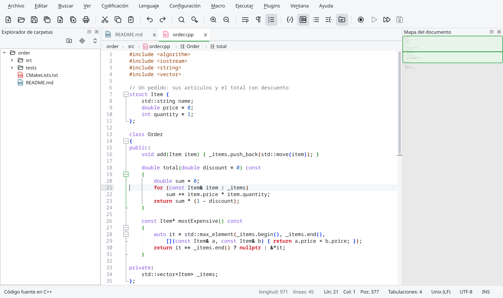
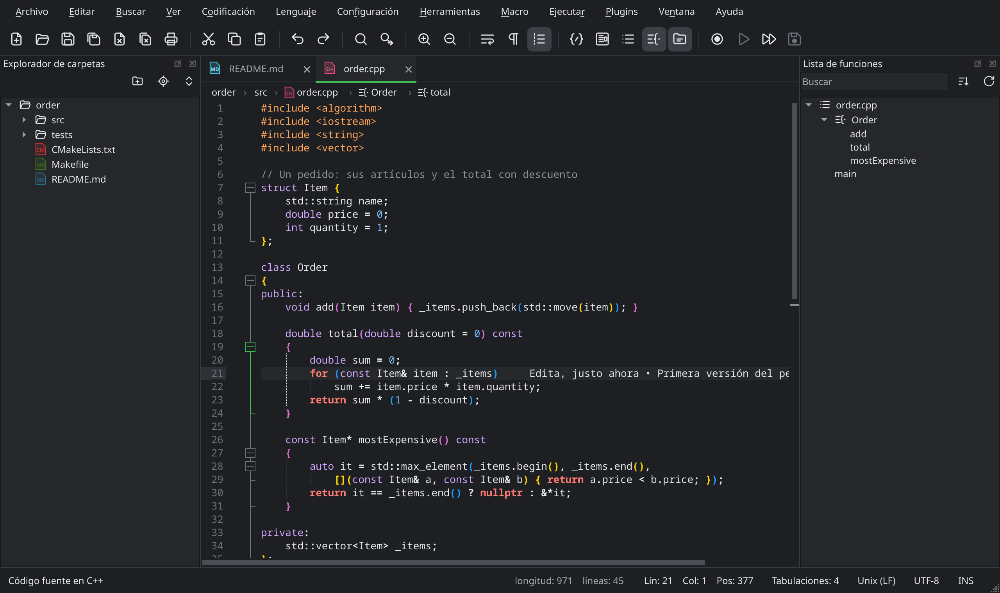
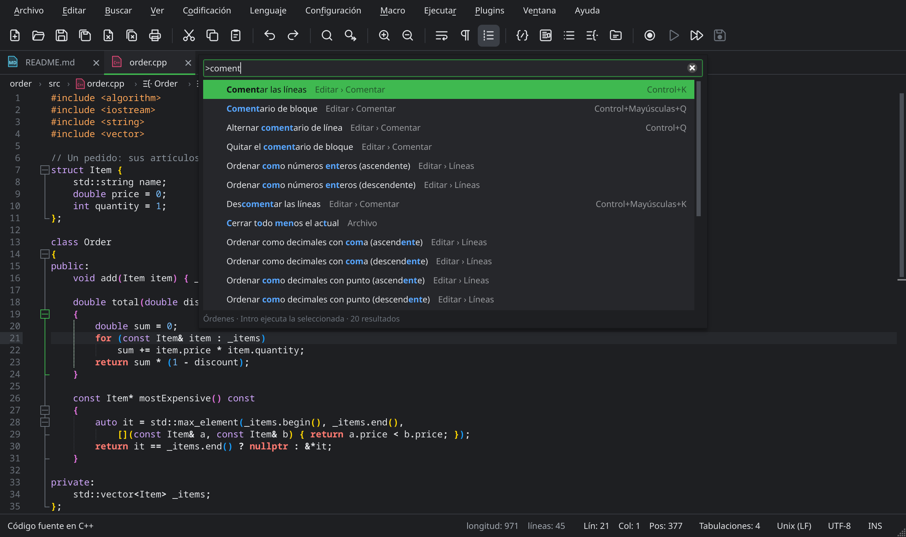
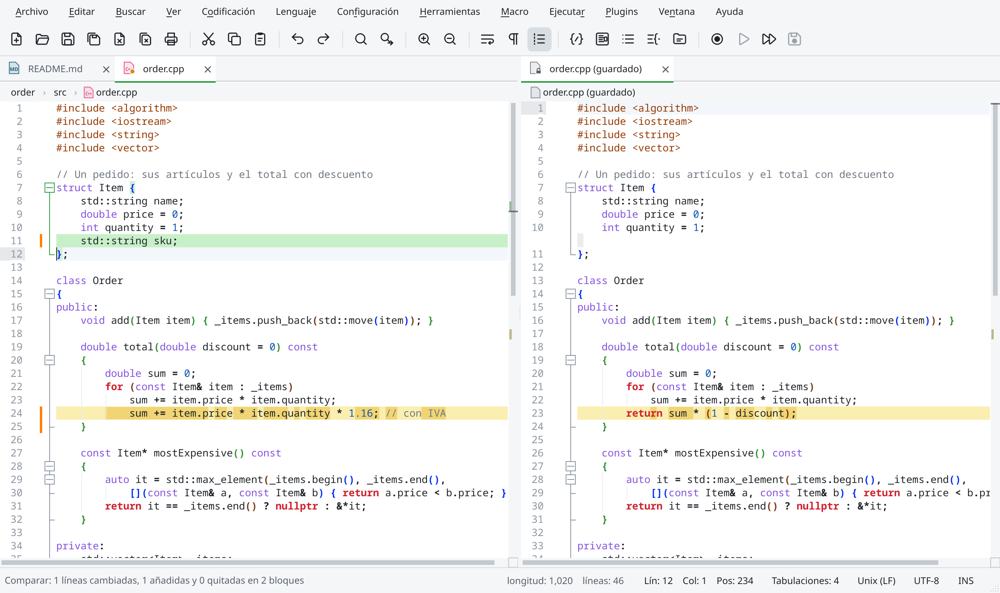
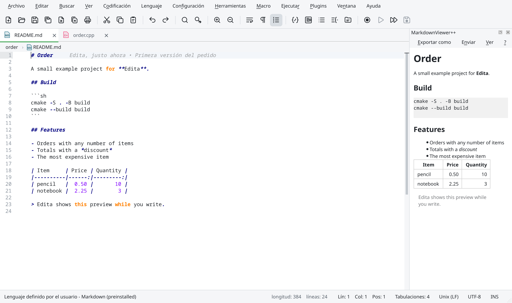
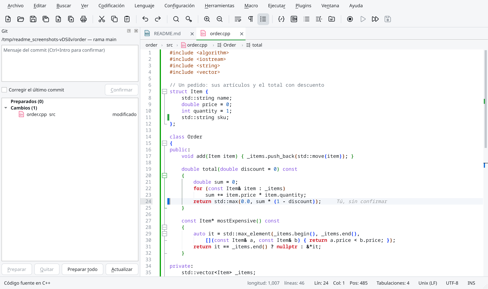
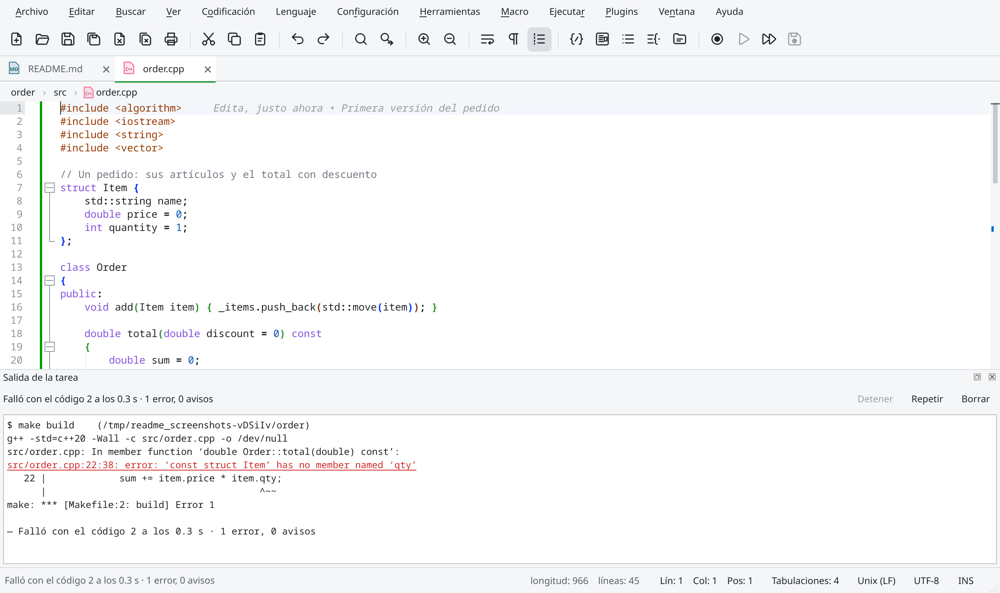
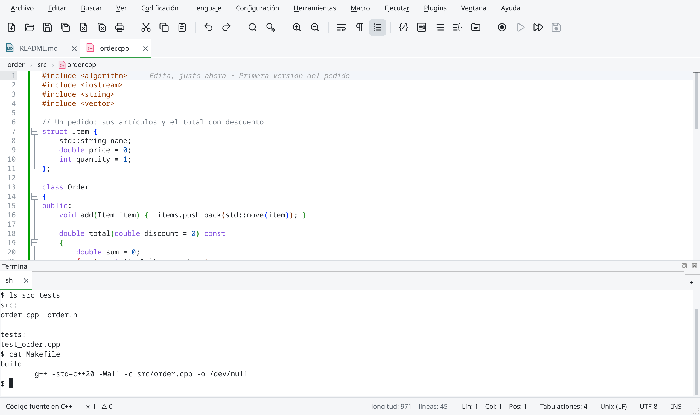
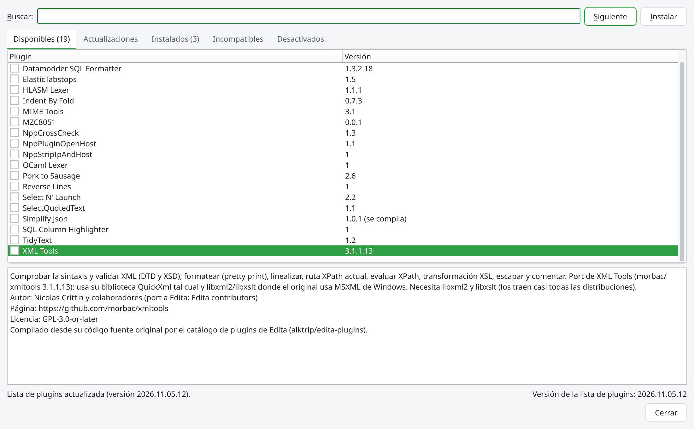

<p align="center">
  
</p>

<h1 align="center">Edita</h1>

<p align="center">
  <b>Un editor de texto nativo para Linux inspirado en Notepad++.</b><br>
  El mismo motor de edición (Scintilla y Lexilla), sus formatos de configuración y sus plugins, con una interfaz moderna en Qt 6.
</p>

<p align="center">
  <a href="https://github.com/alktrip/edita/releases/latest"></a>
  <a href="https://github.com/alktrip/edita/actions/workflows/linux.yml"></a>
  <a href="COPYING"></a>
  
  
</p>

<p align="center">
  <a href="https://github.com/alktrip/edita/releases/latest"><b>⬇ Descargar Edita</b></a> ·
  <a href="PROBAR.md">Probar Edita</a> ·
  <a href="https://github.com/alktrip/edita/issues/new/choose">Reportar un problema</a> ·
  <a href="README.md">English</a>
</p>



## Qué es

Edita lleva a Linux la forma de trabajar de Notepad++: abre tus archivos tal como los dejaste, entiende las mismas codificaciones y finales de línea, colorea más de 90 lenguajes y lee los mismos `langs.xml`, `stylers.xml`, temas, macros, atajos y lenguajes definidos por el usuario. Si vienes de Notepad++, ya sabes usarlo.

Encima de eso, suma lo que hoy se espera de un editor: paleta de órdenes, Git en el margen, terminal integrada, servidores de lenguaje (LSP), comparación de archivos y un manual integrado en español e inglés.

> **Estado:** ya tiene casi todo lo de Notepad++ ([qué falta](docs/paridad-npp.md)). Antes de cada versión estable se publica una versión de prueba; si usas una, [cuéntanos qué encuentras](https://github.com/alktrip/edita/issues/new/choose).

> [!WARNING]
> **La versión para macOS todavía no está lista.** Por limitaciones en el desarrollo (no hay una Mac para probarla a fondo y falta la firma y notarización de Apple), por ahora Edita solo se publica para **Linux** (x86_64 y arm64). El `.dmg` del release 0.0.1, una prueba temprana sin firmar, se retiró. El desarrollo para macOS se retomará cuando haya una versión estable para Linux; mientras tanto, los reportes de macOS no se pueden atender.

## Capturas

| | |
|:---:|:---:|
|  |  |
| **Tema oscuro**, con el explorador y la lista de funciones | **Paleta de órdenes** (Ctrl+Mayús+A): cualquier orden por su nombre |
|  |  |
| **Comparar** con lo guardado o entre dos archivos | **Vista previa de Markdown** mientras escribes (MarkdownViewer++) |
|  |  |
| **Git**: cambios en el margen, blame en la línea y el panel para confirmar | **Tareas del proyecto** (Ctrl+Mayús+B): doble clic en un error lleva a la línea |
|  | |
| **Terminal integrada** (Ctrl+` o Ctrl+Ñ), con pestañas | |

<p align="center">
  <br>
  <b>Plugins de Notepad++</b> compilados para Linux desde su código original, desde un catálogo firmado
</p>

## Características

**Lo de Notepad++**
- Pestañas y dos vistas (con clones), sesiones con nombre y restauración al volver a abrir.
- Detección de codificación y de fin de línea idéntica a la de Notepad++, con más de 40 juegos de caracteres.
- Buscar y reemplazar (normal, extendido y expresiones regulares de Boost), también en archivos, con marcado y marcadores.
- Macros, edición en columna, ocultar líneas, plegado, mapa del documento y lista de funciones.
- Lenguajes definidos por el usuario, temas y el Configurador de estilos, compatibles con los archivos de Notepad++.
- Menú Ejecutar, asignación de atajos, autocompletado con las API de Notepad++, impresión y exportación a PDF.

**Lo que Notepad++ no tiene**
- Paleta de órdenes, ir a archivo y ir a símbolo.
- Git: cambios en el margen, blame y estado en el explorador.
- Terminal integrada.
- Servidores de lenguaje: diagnósticos, completado, ir a la definición, renombrar e inlay hints.
- Comparación de archivos, fragmentos (snippets) y probador de expresiones regulares.
- Barra de búsqueda en línea, ruta de navegación y encabezado fijo.
- Temas claros y oscuros modernos que siguen al sistema.
- Manual de usuario integrado (F1), en español e inglés.

**Plugins**
- **Python Script**, con la API del plugin de Notepad++: muchos de sus scripts funcionan sin cambios.
- **MarkdownViewer++**, la vista previa de Markdown.
- **Editor hexadecimal**, propio de Edita: muestra y edita los bytes de cualquier archivo, también binarios.
- **Detector de secretos**, propio de Edita: subraya las claves de API, tokens y contraseñas escritas en tus archivos y avisa antes de hacer commit de una.
- Un [catálogo firmado](https://github.com/alktrip/edita-plugins) con 22 plugins de Notepad++ compilados para Linux desde su código original (XML Tools, JSON Viewer, MIME Tools, Npp Converter, un formateador de SQL, plugins de lenguaje…), instalables desde **Plugins › Administrador de plugins**.
- **FTP y SFTP**, propio de Edita y en el catálogo: lo que hace NppFTP. Explora servidores por SFTP, FTP, FTPES o FTPS, abre sus archivos y los sube al guardar.
- Un SDK para escribir plugins nuevos o portar los de Notepad++ ([guía](docs/plugins.md)).

## Instalar

En la [última versión](https://github.com/alktrip/edita/releases/latest) hay un AppImage y paquetes .deb y .rpm para **x86_64** (PC) y **arm64** (aarch64: Raspberry Pi 4 y 5, portátiles y servidores ARM). `uname -m` dice cuál es el tuyo.

**AppImage** (cualquier distribución): dale permiso de ejecución y ábrelo.

```sh
chmod +x Edita-*-x86_64.AppImage     # o Edita-*-aarch64.AppImage
./Edita-*-x86_64.AppImage
```

**Debian, Ubuntu, Linux Mint:** `sudo apt install ./edita_*_amd64.deb` (o `_arm64.deb`).

**Fedora, openSUSE y compatibles:** `sudo dnf install ./edita-*.x86_64.rpm` (o `.aarch64.rpm`); en openSUSE, `sudo zypper install ./edita-*.rpm`.

En x86_64 funciona en Ubuntu 22.04 o más nuevo, Debian 12, Fedora 36 y posteriores, openSUSE Tumbleweed y, en general, en las distribuciones con glibc 2.35 o más nueva. En arm64 hace falta glibc 2.39: Ubuntu 24.04, Debian 13, Raspberry Pi OS 13 (trixie), Fedora 40 o más nuevos. Los tres llevan su propio Qt, Python Script y MarkdownViewer++. Los paquetes dejan Edita en el menú y en **Abrir con**. Edita te avisa cuando hay una versión nueva.

**Arch Linux:** el `PKGBUILD` de [`packaging/aur/`](packaging/aur/) compila Edita con el Qt de Arch: `makepkg -si` en esa carpeta.

Para abrir tus archivos con Edita desde el administrador de archivos, elige sus extensiones en **Configuración › Preferencias › Asociación de archivos**.

Uso desde la terminal: `edita [archivos…] [-n línea] [-c columna] [--nosession] [--multiInst] [--openSession archivo]`. La configuración va en `~/.config/edita/`, con los mismos archivos que Notepad++ (`langs.xml`, `stylers.xml`, `config.xml`, `session.xml`, `shortcuts.xml`, `themes/`, `userDefineLangs/`, `plugins/`…).

## Probar y reportar

La guía [PROBAR.md](PROBAR.md) dice qué probar. Para reportar un problema, **Ayuda › Reportar un problema…** abre el formulario de GitHub con tu versión y tu sistema ya escritos. Hay otro formulario para los plugins.

## Compilar

En Arch Linux, desde la carpeta que contiene `editor/`:

```sh
sudo pacman -S --needed qt6-base qt6-5compat qt6-svg qt6-tools qt6-translations cmake ninja gcc openssl python libzip
cmake -S editor -B build -G Ninja -DCMAKE_BUILD_TYPE=RelWithDebInfo
cmake --build build
ctest --test-dir build --output-on-failure      # -LE perf para saltar el de rendimiento
./build/edita
```

| Opción de CMake | Por defecto | |
|---|---|---|
| `EDITA_WERROR` | `ON` | Los avisos del código propio son errores |
| `EDITA_BUILD_TESTS` | `ON` | Las pruebas (QtTest, sin pantalla) |
| `EDITA_BUILD_PLUGINS` | `ON` | Los plugins: el de ejemplo (`plugins/EditaDemo`), Python Script (si hay cabeceras de Python 3) y MarkdownViewer++ |
| `EDITA_UPDATE_CHECK` | `ON` | Avisar de versiones nuevas; una distribución lo desactiva |
| `EDITA_SOURCE_DATA` | `ON` | Buscar los datos también en `data/` del código, para usarlo sin instalar; un paquete lo desactiva |
| `EDITA_APP_ID` | `edita` | Nombre del binario y de `~/.config/<id>/` |

**AppImage y .deb:** `packaging/appimage/build-portable.sh` genera `dist/Edita-<versión>-x86_64.AppImage` y `dist/edita_<versión>_amd64.deb` en Ubuntu 22.04, con Qt, los plugins y Python incluidos ([empaquetado](docs/empaquetado.md)). La CI de Linux los genera en cada cambio. El `PKGBUILD` de AUR está en `packaging/aur/`.

**macOS: todavía no está lista** (ver el aviso al principio). Se conserva una CI (`.github/workflows/macos.yml`, solo a mano) que generaba un `.dmg` universal sin notarizar; no se ha probado desde la fase 55 y no forma parte de los releases.

**Capturas:** las de esta página y las del manual se generan con la aplicación real: `cmake --build build --target edita_readme_images` y `edita_manual_images`.

## Documentación

- [Manual de usuario](data/manual/es): integrado en Edita (F1), en español e inglés.
- [Escribir o portar plugins](docs/plugins.md) y el [catálogo de plugins](https://github.com/alktrip/edita-plugins).
- [Empaquetado](docs/empaquetado.md).
- [Historial de desarrollo](docs/historial.md): cada fase, con el análisis de Notepad++ y sus criterios de aceptación. El plan está en [fase1-analisis.md](docs/fase1-analisis.md).
- [Lo que tiene Notepad++ y Edita no](docs/paridad-npp.md).

## Estructura del código

```
src/core/      núcleo sin widgets: encodings, fin de línea, E/S de archivos, rutas
src/doc/       documentos abiertos sobre Scintilla (FileManager/Buffer de N++)
src/syntax/    langs.xml, stylers.xml/temas, detección de lenguaje, lexers y estilos
src/search/    motor de búsqueda (FindReplaceDlg sin interfaz) y buscar en archivos
src/lsp/       cliente de servidores de lenguaje
src/ui/        ventana, editor (ScintillaEditBase), paneles y diálogos
tests/         QtTest, sin pantalla (QT_QPA_PLATFORM=offscreen); fixtures/ con generate.py
third_party/   Scintilla, Lexilla, boostregex, uchardet y pugixml de Notepad++ (no editar a mano)
data/          langs.model.xml, stylers.model.xml, themes/, autoCompletion/, userDefineLangs/, snippets/ y manual/
translations/  edita_es.ts (español) y edita_en.ts (plurales del inglés)
resources/     logo e iconos de la interfaz (SVG)
plugin-sdk/    edita_plugin.h, la API de plugins; compat/ y cmake/: la capa Win32 para compilar plugins de N++
plugins/       el plugin de ejemplo (EditaDemo), Python Script y MarkdownViewer++
packaging/     appimage/, macos/ y release-notes/ (las notas de cada versión)
docs/          análisis, historial de cada fase, guías e images/ (las capturas de esta página)
```

`third_party/` se regenera con `tools/import-third-party.sh`; los parches locales están en [third_party/PATCHES.md](third_party/PATCHES.md).

## Licencia

Edita es software libre, con licencia [GPL v3 o posterior](COPYING). Se basa en Notepad++ (© Don Ho y el equipo de Notepad++) y en Scintilla y Lexilla (© Neil Hodgson). Los créditos de cada componente están en [NOTICE](NOTICE).
