<p align="center">
  
</p>

<h1 align="center">Edita</h1>

<p align="center">
  <b>English</b> &nbsp;|&nbsp; <a href="README.es.md"><b>Español</b></a>
</p>

<p align="center">
  <b>The Notepad++ experience, built for Linux.</b><br>
  A native Qt 6 text and code editor with the Notepad++ engine, configuration files and plugin API,<br>
  plus the tools developers expect today: LSP, Git, an integrated terminal and project tasks.
</p>

<p align="center">
  <a href="https://github.com/alktrip/edita/releases/latest"></a>
  <a href="https://github.com/alktrip/edita/actions/workflows/linux.yml"></a>
  <a href="COPYING"></a>
  
</p>

<p align="center">
  <a href="#install"><b>Install</b></a> &nbsp;·&nbsp;
  <a href="https://github.com/alktrip/edita/releases"><b>Releases</b></a> &nbsp;·&nbsp;
  <a href="data/manual/en"><b>User manual</b></a> &nbsp;·&nbsp;
  <a href="docs/plugins.md"><b>Plugin SDK</b></a> &nbsp;·&nbsp;
  <a href="https://github.com/alktrip/edita/issues/new/choose"><b>Report a bug</b></a> &nbsp;·&nbsp;
  <a href="README.es.md">Español</a>
</p>

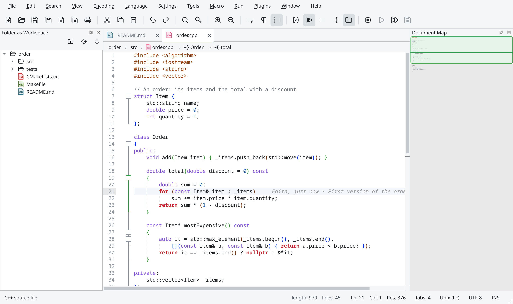

> [!NOTE]
> **Edita 1.0 is in the release-candidate stage.** The current release, [1.0.0-rc.2](https://github.com/alktrip/edita/releases/latest), is a preview of 1.0: use it for real work, but keep copies of what matters and [tell us what you find](https://github.com/alktrip/edita/issues/new/choose).

---

## Why Edita

Notepad++ is one of the most loved editors on Windows, and it only runs on Windows. People who move to Linux lose the workflow they know: its menus and shortcuts, its search, its macros, its themes and its plugins.

**Edita is a native Linux editor that keeps that workflow.** It is built on the same editing engine as Notepad++ (Scintilla and Lexilla), reads the same configuration files and speaks the same plugin API. On top of that, it adds what a developer expects from a modern editor, without becoming a full IDE.

| If you are… | Edita gives you… |
|---|---|
| **Coming from Notepad++** | The same menus, shortcuts, search modes, macros, sessions, themes and `langs.xml` / `stylers.xml` / `shortcuts.xml` files. |
| **A developer on Linux** | A fast native editor with LSP, Git, a terminal, project tasks and file comparison, for when an IDE is more than you need. |
| **A plugin author** | A documented C API compatible with Notepad++ messages, an SDK and a toolchain to port existing Notepad++ plugins. |

---

## Features

<table>
<tr>
<td width="50%" valign="top">

### The Notepad++ core
- Tabs, two views and clones, named sessions and session restore
- Encoding and line-ending detection like Notepad++, 40+ character sets
- Find and replace: normal, extended and Boost regular expressions, in files and folders, with Mark and bookmarks
- Macros, column editor, multi-editing, hide lines, folding
- Document Map, Function List, Folder as Workspace, Clipboard History
- User Defined Languages, Style Configurator and 30 themes, all in Notepad++ formats
- Run menu, Shortcut Mapper, auto-completion from Notepad++ API files, printing and PDF export
- 95 languages highlighted out of the box

</td>
<td width="50%" valign="top">

### Modern development tools
- **Language servers (LSP):** diagnostics, completion, hover, signature help, go to definition, references, rename, formatting, code actions, workspace symbols and inlay hints
- **Git:** changes in the margin, revert or stage a single block, a commit panel, blame and status in the file explorer
- **Integrated terminal** with tabs (libvterm)
- **Project tasks:** Make, CMake, npm/pnpm/yarn/bun, Cargo, Go, pytest, Meson and just, with clickable errors
- **Command palette**, go to file and go to symbol
- **Compare** two files, or a file with its saved or Git version
- **Local history** of every saved version
- **Secret scanner:** API keys, tokens and passwords are underlined as you type, and a commit that contains one asks first
- Snippets (VS Code format), regex tester, spell checking (Hunspell), external formatters, breadcrumbs, sticky scroll

</td>
</tr>
</table>

Edita is written in C++20 on **Qt 6**, with **Scintilla 5** and **Lexilla** as its editing engine. It includes a built-in [user manual](data/manual/en) (F1), and its interface is available in English and Spanish.

---

## Plugins: the Notepad++ ecosystem, on Linux

Plugins are what makes Notepad++ more than an editor, so Edita was designed around them.

**Why Windows plugins cannot just be loaded.** A Notepad++ plugin is a Windows DLL that calls the Win32 API. Linux cannot load it, so Edita does not claim binary compatibility. Edita offers **API compatibility**: the same exported functions, the same `NPPM_*` messages and `NPPN_*` notifications, and the same `FuncItem` menu entries. That way a plugin's source code can be built for Linux.

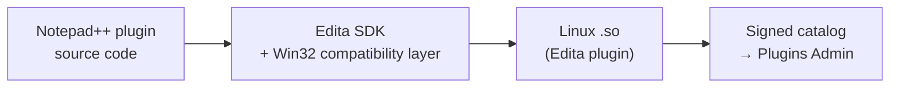

- **Plugin API.** [`edita_plugin.h`](plugin-sdk/edita_plugin.h) mirrors Notepad++'s plugin interface for Linux: UTF-8 strings, `NPPM_*`/`NPPN_*` with the same numbers, docking panels, inter-plugin messages and Scintilla access. It is **stable for the whole 1.x series**: a plugin built for 1.0 keeps working in any 1.x ([what is guaranteed](docs/plugins.md#qué-no-cambia-en-edita-1x)).
- **Porting toolkit.** A Win32 compatibility layer (windows, dialogs from `.rc` files, common controls, GDI drawing on Qt) and *recipes* that build a Notepad++ plugin from its original source with a few patches. `edita --build-recipe` and `edita --check-plugin` build and test them without a GUI.
- **Signed catalog.** [edita-plugins](https://github.com/alktrip/edita-plugins) builds the recipes in CI and publishes an Ed25519-signed list. **Plugins › Plugins Admin** installs from it in one click. It currently lists **22 Notepad++ plugins** (XML Tools, JSON Viewer, MIME Tools, Npp Converter, a SQL formatter, language lexers…) and **FTP and SFTP**, Edita's own take on NppFTP: browse servers over SFTP, FTP, FTPES or FTPS, open their files and upload them when you save. The plugins are prebuilt for x86_64 and arm64.
- **Bundled plugins.** **Python Script**, with the API of the Notepad++ plugin (many scripts run unchanged), **MarkdownViewer++**, a live Markdown preview, a **Hex Editor** that works on the bytes of any file, and **Secret Scanner**, Edita's own: it underlines API keys, tokens and passwords written in your files and warns before you commit one.

**Writing a plugin:** start with the [plugin guide](docs/plugins.md) and the [example plugin](plugins/EditaDemo). **Porting one:** add a recipe to [edita-plugins](https://github.com/alktrip/edita-plugins) with a pull request, and the catalog CI builds it, tests it and publishes it.

---

## Screenshots

<table>
<tr>
<td width="50%">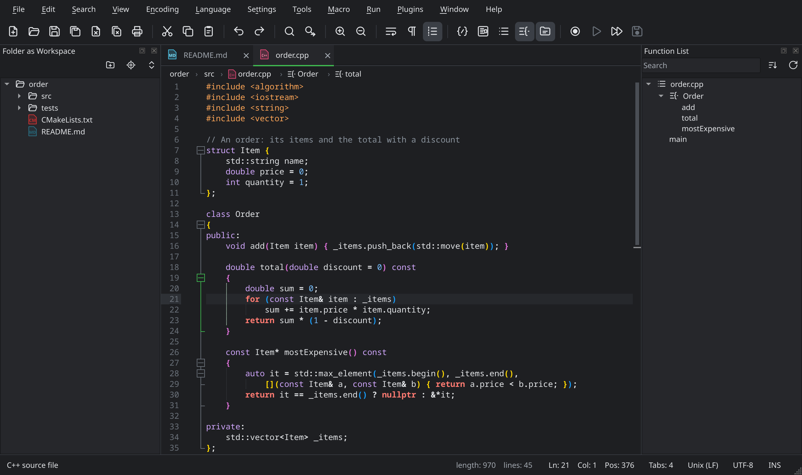</td>
<td width="50%">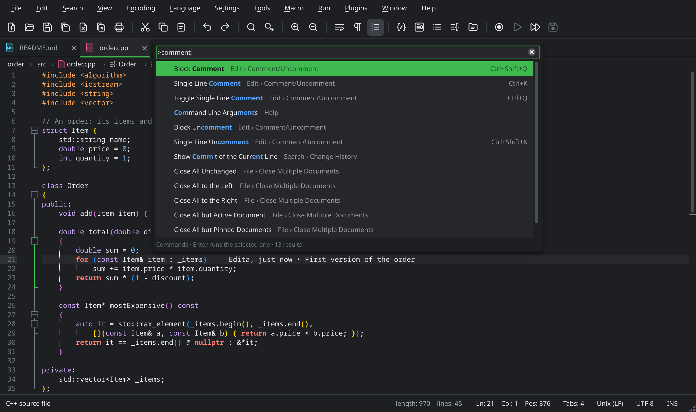</td>
</tr>
<tr>
<td align="center"><b>Dark theme</b> with the file explorer and the Function List</td>
<td align="center"><b>Command palette</b> (Ctrl+Shift+A): any command by name</td>
</tr>
<tr>
<td width="50%">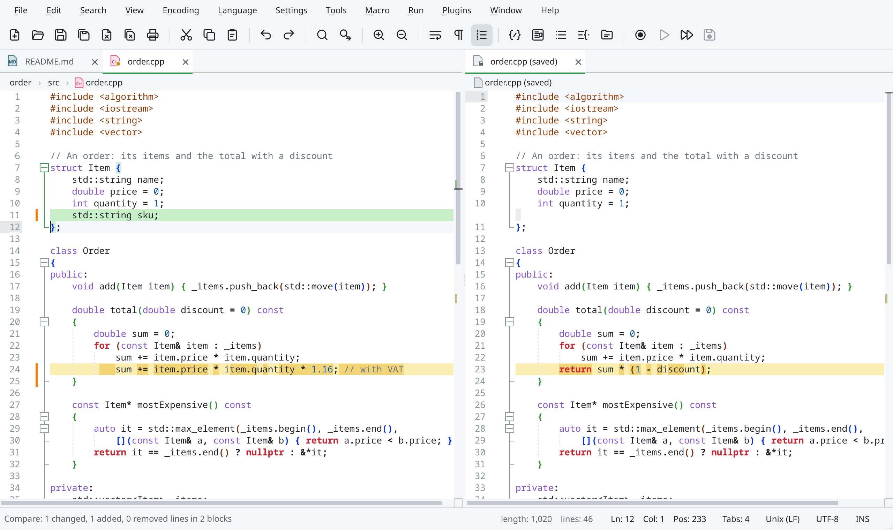</td>
<td width="50%">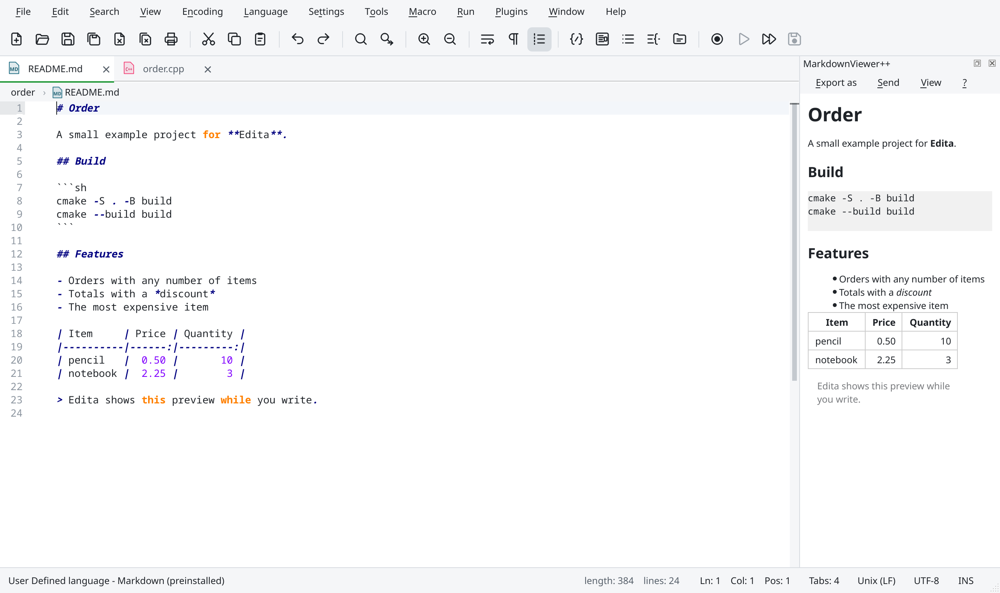</td>
</tr>
<tr>
<td align="center"><b>Compare</b> with the saved version, with Git or with another file</td>
<td align="center"><b>Markdown preview</b> while you type (MarkdownViewer++)</td>
</tr>
<tr>
<td width="50%">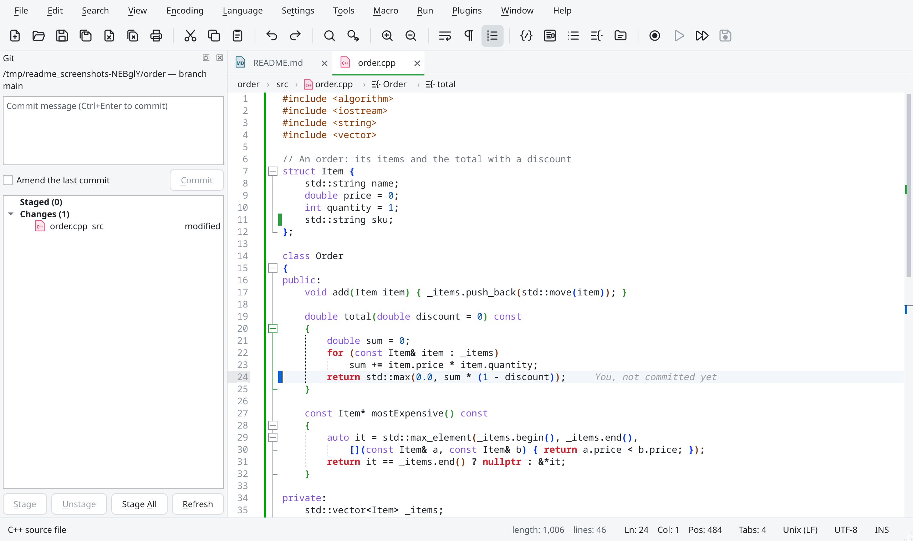</td>
<td width="50%">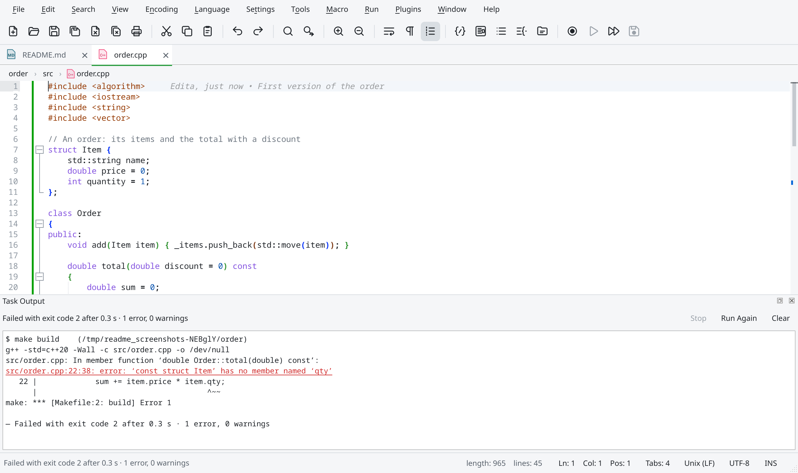</td>
</tr>
<tr>
<td align="center"><b>Git</b>: changes in the margin, inline blame and the commit panel</td>
<td align="center"><b>Project tasks</b> (Ctrl+Shift+B): compiler errors you can double click</td>
</tr>
<tr>
<td width="50%">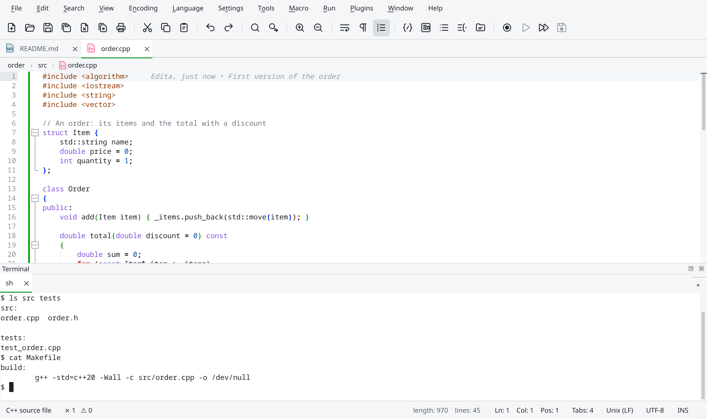</td>
<td width="50%">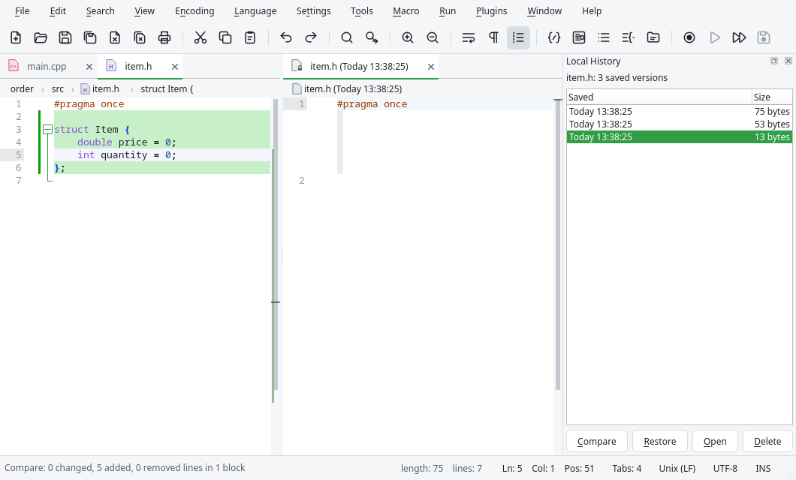</td>
</tr>
<tr>
<td align="center"><b>Integrated terminal</b> (Ctrl+`), with tabs</td>
<td align="center"><b>Local history</b>: every saved version, ready to compare or restore</td>
</tr>
</table>

<p align="center">
  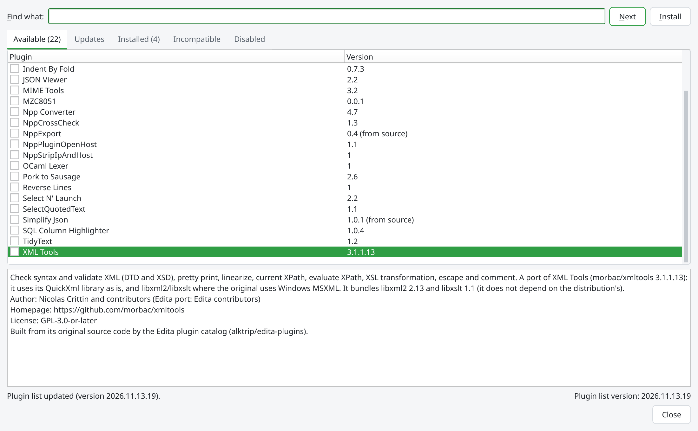<br>
  <b>Plugins Admin</b> with the signed catalog of Notepad++ plugins built for Linux
</p>

---

## Install

Every [release](https://github.com/alktrip/edita/releases/latest) ships an AppImage, a `.deb` and an `.rpm` for **x86_64** and **arm64** (aarch64). `uname -m` tells which one your computer uses. All of them include their own Qt, Python Script and MarkdownViewer++.

| Distribution | Package | Install |
|---|---|---|
| **Debian, Ubuntu, Linux Mint** | `edita_<version>_amd64.deb` / `_arm64.deb` | `sudo apt install ./edita_*.deb` |
| **Fedora, openSUSE** and compatible | `edita-<version>-1.x86_64.rpm` / `.aarch64.rpm` | `sudo dnf install ./edita-*.rpm`<br>`sudo zypper install ./edita-*.rpm` |
| **Any distribution** | `Edita-<version>-x86_64.AppImage` / `-aarch64.AppImage` | `chmod +x Edita-*.AppImage && ./Edita-*.AppImage` |
| **Arch Linux** | [`packaging/aur/PKGBUILD`](packaging/aur/) (builds with Arch's Qt) | `makepkg -si` in that folder |

**Requirements.** On x86_64: Ubuntu 22.04 or newer, Debian 12, Fedora 36 and later, openSUSE Tumbleweed, and in general any distribution with glibc 2.35 or newer. On arm64: Ubuntu 24.04, Debian 13, Raspberry Pi OS 13 (trixie), Fedora 40 or newer (glibc 2.39). Wayland and X11 are both supported.

The packages add Edita to the applications menu and to **Open With**. To make Edita the default for some file types, use **Settings › Preferences › File Association**. Edita tells you when a new version is available. The Arch `PKGBUILD` is not published on the AUR yet.

**Command line:**

```sh
edita [files…] [-n line] [-c column] [-l language] [--nosession] [--multiInst] [--openSession file]
```

Settings live in `~/.config/edita/`, with the same files as Notepad++ (`config.xml`, `langs.xml`, `stylers.xml`, `shortcuts.xml`, `session.xml`, `themes/`, `userDefineLangs/`, `plugins/`…), so you can bring your Notepad++ configuration with you.

---

## Project status

| | |
|---|---|
| **Current release** | [1.0.0-rc.2](https://github.com/alktrip/edita/releases/latest), a release candidate, so it may still contain bugs |
| **Next milestone** | 1.0.0: the same version with a new number, if testers find nothing serious. After that, 1.1: see the [roadmap](ROADMAP.md) |
| **Platforms** | Linux x86_64 and arm64. macOS is paused until 1.0 for Linux is out |
| **Notepad++ parity** | Almost every Notepad++ command is implemented. What is still missing (right-to-left text and project panels) is listed in [docs/paridad-npp.md](docs/paridad-npp.md) |
| **Quality** | 71 automated test suites, run in CI on x86_64 and arm64; the packages are installed on Fedora and Debian in CI before every release |

**Release notes:** [GitHub Releases](https://github.com/alktrip/edita/releases) (English and Spanish) · **Development history:** [docs/historial.md](docs/historial.md), one entry per phase (Spanish).

---

## How Edita compares

Edita is not trying to replace everything. Here is where it fits:

| | Edita | Notepad++ | Kate | VS Code |
|---|---|---|---|---|
| **Platform** | Linux | Windows | Linux, Windows, macOS | Linux, Windows, macOS |
| **Toolkit** | Qt 6 (native) | Win32 (native) | Qt / KDE Frameworks (native) | Electron |
| **Notepad++ workflow and config files** | Yes | Yes | No | No |
| **Notepad++ plugins** | Ported from source (API compatible) | Native DLLs | No | No |
| **LSP, Git, terminal** | Built in | Through plugins | Built in | Built in |
| **Extension ecosystem** | Small and growing | Large | KDE plugins | Very large marketplace |

- **Choose Edita** if you want the Notepad++ way of working on Linux, with its files and plugins, plus modern developer tools in a native application.
- **Notepad++** remains the reference on Windows. Edita follows its behavior and file formats on purpose.
- **Kate** is an excellent native editor with deep KDE integration. Edita's difference is Notepad++ compatibility.
- **VS Code** has the largest extension marketplace and is the better choice if you depend on it.

---

## Contributing

Edita is an open source project, and it grows with the people who use it. The [contributing guide](CONTRIBUTING.md) explains each way to help.

- **Try it and report bugs.** The [testing guide](PROBAR.md#testing-edita) says what to test. **Help › Report a Problem…** opens a bug report with your version and system already filled in.
- **Propose features** in [Issues](https://github.com/alktrip/edita/issues/new/choose).
- **Port a Notepad++ plugin** with a recipe in [edita-plugins](https://github.com/alktrip/edita-plugins), or **write a new one** with the [SDK](docs/plugins.md).
- **Contribute code.** The [build instructions](#build-from-source) are below. Every change needs its tests (`ctest`), and the codebase builds with `-Werror` on GCC and Clang.

---

## Build from source

<details>
<summary><b>Build, test and package</b></summary>

On Arch Linux, from the folder that contains `editor/`:

```sh
sudo pacman -S --needed qt6-base qt6-5compat qt6-svg qt6-tools qt6-translations cmake ninja gcc openssl python libzip
cmake -S editor -B build -G Ninja -DCMAKE_BUILD_TYPE=RelWithDebInfo
cmake --build build
ctest --test-dir build --output-on-failure      # -LE perf skips the performance test
./build/edita
```

Edita needs Qt 6.7 or newer, a C++20 compiler, CMake 3.25+ and Ninja. Hunspell, libzip, OpenSSL and the Python 3 headers enable spell checking, the Plugins Admin, the catalog signature and Python Script.

| CMake option | Default | |
|---|---|---|
| `EDITA_WERROR` | `ON` | Warnings in Edita's own code are errors |
| `EDITA_BUILD_TESTS` | `ON` | The tests (QtTest, headless) |
| `EDITA_BUILD_PLUGINS` | `ON` | The example plugin, Python Script (if the Python 3 headers are present) and MarkdownViewer++ |
| `EDITA_UPDATE_CHECK` | `ON` | New version notices; distribution packages turn it off |
| `EDITA_SOURCE_DATA` | `ON` | Also look for data in the source tree's `data/`, to run without installing |
| `EDITA_APP_ID` | `edita` | Name of the binary and of `~/.config/<id>/` |

**Packages:** `packaging/appimage/build-portable.sh` builds the AppImage, `.deb` and `.rpm` inside Ubuntu 22.04 (no Docker or root needed). The Linux CI builds them for x86_64 and arm64 on every push. See [docs/empaquetado.md](docs/empaquetado.md).

**Screenshots:** the images on this page and in the manual are taken from the real application by `edita_readme_images` and `edita_manual_images`.

</details>

<details>
<summary><b>Source layout</b></summary>

```
src/core/      core without widgets: encodings, line endings, file I/O, paths, local history, tasks
src/doc/       open documents on top of Scintilla (Notepad++'s FileManager/Buffer)
src/syntax/    langs.xml, stylers.xml and themes, language detection, lexers and styles
src/search/    search engine (FindReplaceDlg without UI) and find in files
src/lsp/       language server client
src/ui/        main window, editor (ScintillaEditBase), panels and dialogs
tests/         QtTest suites, headless (QT_QPA_PLATFORM=offscreen)
third_party/   Scintilla, Lexilla, boostregex, uchardet and pugixml from Notepad++; libvterm; md4c
data/          langs.model.xml, stylers.model.xml, themes/, autoCompletion/, userDefineLangs/, snippets/, manual/
translations/  edita_es.ts (Spanish) and edita_en.ts (English plurals)
plugin-sdk/    edita_plugin.h (the plugin API), compat/ and cmake/ (the Win32 layer for Notepad++ plugins)
plugins/       the example plugin (EditaDemo), Python Script and MarkdownViewer++
packaging/     appimage/, deb/, rpm/, aur/ and release-notes/
docs/          design notes, one document per development phase, guides and images/
```

`third_party/` is regenerated with `tools/import-third-party.sh`; local patches are listed in [third_party/PATCHES.md](third_party/PATCHES.md).

</details>

---

## Documentation

- **[User manual](data/manual/en)**, also built into Edita (F1), in English and [Spanish](data/manual/es)
- **[Plugin guide and SDK](docs/plugins.md)** and the **[plugin catalog](https://github.com/alktrip/edita-plugins)**
- **[Packaging](docs/empaquetado.md)**: AppImage, `.deb`, `.rpm`, x86_64 and arm64
- **[Notepad++ parity](docs/paridad-npp.md)**: what Notepad++ has and Edita does not yet
- **[Roadmap](ROADMAP.md)** and **[contributing guide](CONTRIBUTING.md)**
- **[Development history](docs/historial.md)**: every phase, with its analysis of Notepad++

Most of the design documents are in Spanish; the manual, the release notes and this page are also in English.

---

<p align="center">
  <b>Edita</b> is free software, licensed under the <a href="COPYING">GNU GPL v3 or later</a>.<br>
  It is derived from <a href="https://notepad-plus-plus.org">Notepad++</a> (© Don Ho and the Notepad++ team)
  and uses <a href="https://www.scintilla.org">Scintilla and Lexilla</a> (© Neil Hodgson), Qt and other open source components,<br>
  credited in <a href="NOTICE">NOTICE</a>. Thank you to everyone who builds and maintains them.
</p>

<p align="center">
  <a href="https://github.com/alktrip/edita">Repository</a> &nbsp;·&nbsp;
  <a href="https://github.com/alktrip/edita/releases">Releases</a> &nbsp;·&nbsp;
  <a href="data/manual/en">Documentation</a> &nbsp;·&nbsp;
  <a href="https://github.com/alktrip/edita/issues">Issues</a>
</p>
