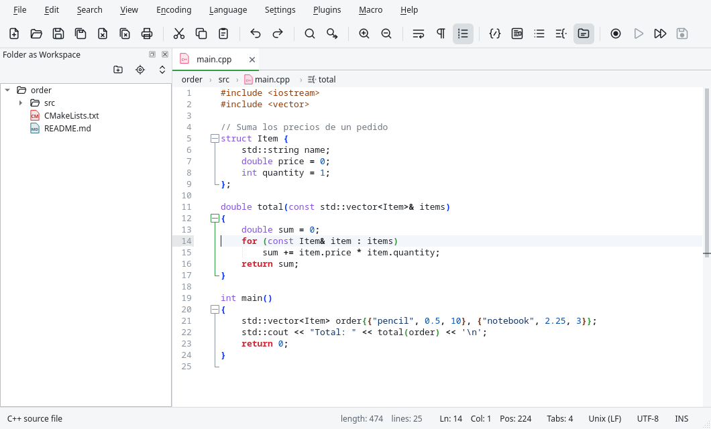

# Introduction

Edita is a text and source code editor for Linux and macOS, inspired by Notepad++. It uses the
same editing engine as Notepad++ (Scintilla and Lexilla, with Boost regular expressions) and a
native Qt 6 interface. It reads the Notepad++ configuration formats (`langs.xml`, `stylers.xml`,
themes, `shortcuts.xml`, user defined languages, autocompletion files), so what you know from
Notepad++ works here too.

On top of what Notepad++ offers, Edita adds features from modern editors: a command palette,
language servers (diagnostics, completion, go to definition…), Git integration, file
comparison, snippets, an integrated terminal and a regular expression tester.

This manual describes every feature. Use the search field above the contents to find a topic:
it ignores case and accents. Menu commands appear with their current shortcut, so if you change
a shortcut in {{actionShortcutMapper}}, the manual shows the new one.

## Installation

### Linux

The simplest way is the **AppImage**: a single file that works on Ubuntu 22.04 or later,
Debian 12 or later, Fedora 36 or later and most current distributions.

1. Download `Edita-<version>-x86_64.AppImage` from the project's Releases page.
2. Make it executable: right click › Properties › Allow executing, or in a terminal
   `chmod +x Edita-*.AppImage`.
3. Run it with a double click or from a terminal.

You can also build Edita from source with CMake (Qt 6, a C++20 compiler and Ninja); the
`README.md` file of the project lists the steps and the packages needed.

### macOS

Download `Edita-<version>-macos-universal.dmg` (it runs on Apple Silicon and Intel Macs),
open it and drag **Edita** to the Applications folder. The application is not notarized by
Apple, so the first time you must open it with right click › **Open**, or allow it in
System Settings › Privacy & Security › **Open Anyway**.

On macOS the shortcuts that use Ctrl on Linux use the Command key (⌘). This manual always
shows the shortcuts of the system you are using.

## Starting Edita

Run `edita` to open the editor. You can pass files and options on the command line:

```
edita [files…] [-n line] [-c column] [--nosession] [--multiInst]
```

| Option | Meaning |
|---|---|
| `files…` | Files to open. Folders are not opened as files. |
| `-n line` | Places the cursor on that line of the (last) file. |
| `-c column` | Places the cursor on that column. |
| `--nosession` | Neither restores nor saves the session (the files that were open). |
| `--multiInst` | Opens a new window even if Edita is already running. |

Edita runs as a **single instance**: if a window is already open, the files you open from the
file manager or the command line are opened as tabs in that window. To always open a new window,
change **Instances** in {{actionPreferences}} (General page) or use `--multiInst`.

When Edita starts it restores the previous session: the files that were open, the cursor position
in each one and the documents that were never saved (see
[Sessions and backups](02-files.md#sessions-and-backups)).

## The window

From top to bottom, the Edita window has these parts:



- **Menu bar**: every command is in a menu. The commands also appear in the
  [command palette](05-views.md#command-palette).
- **Toolbar**: buttons for the most common commands (new, open, save, cut, copy, paste, undo,
  find, zoom, word wrap, show all characters, panels and macros). It can be hidden or made
  smaller in {{actionPreferences}}.
- **Tab bar**: one tab per open document. A dot on a tab means the document has unsaved changes.
  Drag the tabs to reorder them; middle click closes a tab and right click shows a menu with
  more commands (close the others, copy the path, open the containing folder or a terminal
  there…).
- **Breadcrumbs** (optional): the folders, the file and the class and function where the cursor
  is. Click a folder to list its files, or the file or a symbol to list the symbols of the
  document, with a search field.
- **Editor**: the text, with line numbers, a margin for bookmarks and other symbols, the change
  history margin and the fold margin.
- **Panels**: the Document List, Function List, Folder as Workspace, Document Map, Search
  Results, Problems and Terminal panels can be shown around the editor (see
  [Views and panels](05-views.md)).
- **Status bar**: the language, the cursor position, the selection, the end of line, the
  encoding, the indentation and the insert/overwrite mode.

### The status bar

Most fields of the status bar are buttons:

| Field | Click to… |
|---|---|
| Language | Choose the syntax highlighting language from a searchable list. |
| `Ln: … Col: …` | Go to a line ({{actionGoTo}}). |
| End of line | Convert the line endings to Windows (CR LF), Unix (LF) or Macintosh (CR). |
| Encoding | Reopen the file in another encoding or convert it. |
| Indentation | Choose tabs or spaces and the indentation width. |
| `INS` / `OVR` | Switch between insert and overwrite mode (also with the Insert key). |

## The welcome page

When there are no open documents, Edita shows the welcome page instead of an empty document. It
has shortcuts to create a file, open a file or a folder, the recent files and folders, the
appearance (light, dark or follow the system, and the color theme) and a list of useful
shortcuts. Start typing to write in a new document, or press Esc to close the page.

The page can be opened at any moment with {{actionWelcomePage}}, and turned off with the option
at the bottom of the page or in {{actionPreferences}} (General page).

## Getting help

- {{actionUserManual}} opens this manual. The arrows go back and forward through the pages you
  visited; the house goes to the first chapter. {{key:actionCommandPalette}} opens the command
  palette, the fastest way to find a command when you don't remember its menu.
- {{actionAbout}} shows the version of Edita.
