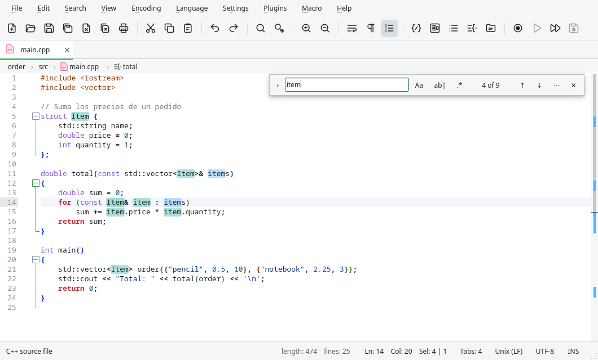
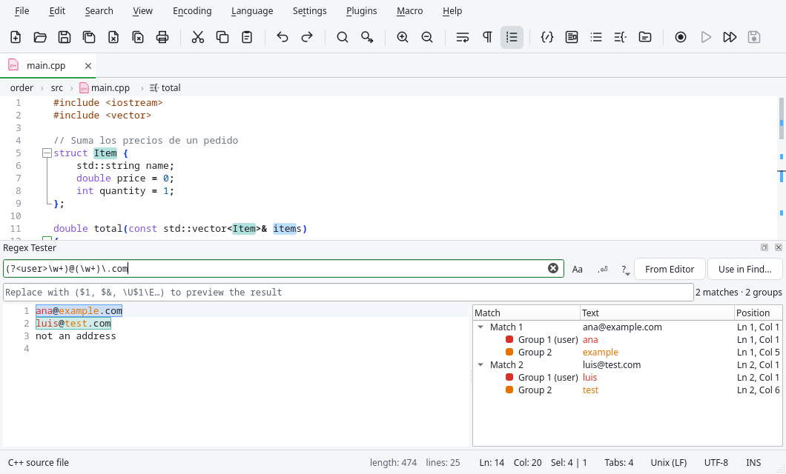

# Search and replace

## The find bar

{{actionFind}} opens a bar in the top right corner of the editor. The matches are highlighted as
you type, and the bar shows how many there are and which one is selected ("3 of 17").

| Key or button | Action |
|---|---|
| Enter / Shift+Enter | Next / previous match. |
| Alt+C | Match case. |
| Alt+W | Match whole word only. |
| Alt+R | Use a regular expression. |
| Esc | Closes the bar and leaves the current match selected. |

{{actionReplace}} opens the same bar with the replace field. Enter in that field replaces the
current match and goes to the next one, and the **All** button (Ctrl+Alt+Enter) replaces all of
them. The **›** button on the left of the bar shows or hides the replace field.

The **⋯** button opens the Find dialog with the text of the bar. If you prefer the dialog of
Notepad++ for Ctrl+F and Ctrl+H, turn off **Ctrl+F and Ctrl+H open the inline find bar**
(Searching page of {{actionPreferences}}).

## The Find dialog

The dialog has three tabs: **Find**, **Replace** and **Find in Files**. They share the text to
search and these options:

- **Match whole word only** and **Match case**.
- **Wrap around**: after the last match, continue from the start of the document.
- **Backward direction**: search upwards.
- **In selection**: search or replace only inside the selected text.
- **Search Mode**: Normal, Extended or Regular expression (see below).

Besides **Find Next**, the Find tab has **Count**, **Find All in Current Document** and **Find All
in All Opened Documents**; the last two list the matches in the
[Search Results](#the-search-results-panel) panel. The Replace tab has **Replace**, **Replace All**
and **Replace All in All Opened Documents** (Edita asks for confirmation before the last one,
unless it is turned off in the Searching page).

Once the dialog has been used, these commands repeat the search without opening it:

| Command | What it does |
|---|---|
| {{actionFindNext}} / {{actionFindPrevious}} | Next / previous match of the last search. |
| {{actionFindSelectedNext}} / {{actionFindSelectedPrevious}} | Searches the selected text (or the word at the cursor). |

**Fill Find field with selected text** (Searching page) puts the selection in the search field
when the dialog or the bar opens.

## Search modes

### Normal

The text is searched exactly as written.

### Extended

Like Normal, but these sequences represent special characters:

| Sequence | Character |
|---|---|
| `\n` | Line feed (LF) |
| `\r` | Carriage return (CR) |
| `\t` | Tab |
| `\0` | Null character |
| `\\` | Backslash |
| `\xFF` | Character with that hexadecimal code |
| `\dNNN`, `\oNNN`, `\bNNNNNNNN`, `￿` | Decimal, octal, binary or Unicode code |

For example, searching `\r\n` and replacing with `\n` converts Windows line endings to Unix.

### Regular expressions

Edita uses the same regular expressions as Notepad++ (Boost, compatible with Perl). The most
common elements:

| Expression | Matches |
|---|---|
| `.` | Any character (also line ends with **. matches newline**) |
| `\d`, `\w`, `\s` | A digit, a word character, a space |
| `[abc]`, `[^abc]`, `[a-z]` | One of those characters, any other, a range |
| `*`, `+`, `?`, `{2,5}` | Repetition: 0 or more, 1 or more, 0 or 1, from 2 to 5 |
| `*?`, `+?` | The same, as few as possible |
| `^`, `$` | Start and end of line |
| `\b` | Start or end of a word |
| `(…)`, `(?<name>…)` | A group (numbered or named) |
| `a|b` | `a` or `b` |
| `(?=…)`, `(?!…)` | Followed / not followed by |

In the replacement, `$1` or `\1` is the text of group 1, `$&` or `$0` the whole match, and
`\U…\E`, `\L…\E` change it to uppercase or lowercase. For example, searching
`(\w+)@(\w+)\.com` and replacing with `\U$2\E: $1` turns `ana@example.com` into `EXAMPLE: ana`.

To try out an expression before using it, use the [regex tester](#regex-tester).

## Find in Files

{{actionFindInFiles}} opens the Find in Files tab. Besides the text and the options:

- **Directory**: the folder where to search. **Follow current doc.** uses the folder of the
  current document.
- **Filters**: the names of the files to search, separated by spaces: `*.cpp *.h`. A filter
  that starts with `!` excludes files: `*.* !*.min.js`. `!\build` excludes the folder `build`
  of the first level, and `!+\node_modules` excludes every folder with that name at any depth.
- **In all sub-folders** and **In hidden folders**.

**Find All** lists the matches of every file in the Search Results panel. **Replace in Files**
replaces in every file found, including files that are not open, after asking for confirmation.
The right click menu of the Folder as Workspace panel also has **Find in Files…**, to search in a
folder of the workspace.

## The search results panel

The results of **Find All** and **Find in Files** appear in the Search Results panel
({{key:actionNextResult}} goes to the next one). Each search is a group with the searched text and
its options; inside, each file with its matching lines, and the matched text highlighted.

- Double click (or Enter) on a line opens the file at that match.
- {{actionNextResult}} and {{actionPreviousResult}} go through the results without touching the
  panel.
- The **Search Results Window** command (F7) shows or hides the panel.

## Regex tester

{{actionRegexTester}} opens a panel to build and test regular expressions:

- **Expression**: the regular expression. The matches are highlighted in the test text while you
  type, each group with its own color.
- **Text**: the test text. **From Editor** copies the selection (or the whole document).
- The list shows every match with its position and its groups (number, name and text).
- **Replacement**: type a replacement to see the result in the preview below.
- **Quick reference** (the button next to the expression): a menu with the syntax; choose an
  element to insert it in the expression.
- **Use in Find…** opens the Find dialog with the expression and the options.

The tester uses the same engine as the Find dialog, so what matches here matches in the document.

## Go to

| Command | What it does |
|---|---|
| {{actionGoTo}} | Asks for a line number and goes there. |
| {{actionGoToFile}} | Opens a file by name (see [Creating and opening files](02-files.md#creating-and-opening-files)). |
| {{actionGoToSymbol}} | Lists the functions, classes and other symbols of the document; type to filter. |
| {{actionGoToMatchingBrace}} | Goes to the bracket that pairs with the one at the cursor. |

In the {{actionGoToFile}} field, start with `:` to go to a line (`:120` or `:120:5` for line and
column), with `@` to go to a symbol, and with `>` to run a command.

## Marking text

**Smart highlighting** marks every occurrence of the selected word in the visible part of the
document (and of the other view, with **Highlight another view**). It is configured in the
Highlighting page of {{actionPreferences}}: match case, whole words, or the options of the Find
dialog.

The **token styles** color a word everywhere in the document with one of five colors, to follow
it in a long text:

- **Style All Occurrences of Token** colors every occurrence of the selected word (or the word at
  the cursor): {{item:actionStyleAll1}}, {{item:actionStyleAll2}}, {{item:actionStyleAll3}}, {{item:actionStyleAll4}},
  {{item:actionStyleAll5}}.
- **Style One Token** colors only the selection: {{item:actionStyleOne1}}, {{item:actionStyleOne2}},
  {{item:actionStyleOne3}}, {{item:actionStyleOne4}}, {{item:actionStyleOne5}}.
- **Clear Style** removes a color: {{item:actionUnstyle1}}, {{item:actionUnstyle2}}, {{item:actionUnstyle3}},
  {{item:actionUnstyle4}}, {{item:actionUnstyle5}}, or all of them with {{item:actionUnstyleAll}}.
- **Jump to Next Style** and **Jump to Previous Style** go to the next or previous word of a
  color: {{item:actionNextStyle1}}, {{item:actionNextStyle2}}, {{item:actionNextStyle3}}, {{item:actionNextStyle4}},
  {{item:actionNextStyle5}}; {{item:actionPreviousStyle1}}, {{item:actionPreviousStyle2}},
  {{item:actionPreviousStyle3}}, {{item:actionPreviousStyle4}}, {{item:actionPreviousStyle5}}.
  {{item:actionNextFoundMark}} and {{item:actionPreviousFoundMark}} do the same with the texts marked with
  the "Find Mark Style" (used by plugins and scripts).

The colors of the styles can be changed in {{actionStyleConfigurator}} (Global Styles).

## Bookmarks

A bookmark marks a line to come back to it later. It is shown as a symbol in the margin; click
the margin to add or remove one.

| Command | What it does |
|---|---|
| {{actionToggleBookmark}} | Adds or removes the bookmark of the current line. |
| {{actionNextBookmark}} / {{actionPreviousBookmark}} | Goes to the next / previous bookmark (wrapping around). |
| {{actionClearBookmarks}} | Removes all the bookmarks of the document. |
| {{actionInverseBookmarks}} | Marks the lines without bookmark and unmarks the others. |
| {{actionCutMarkedLines}} / {{actionCopyMarkedLines}} | Cuts / copies the bookmarked lines. |
| {{actionPasteMarkedLines}} | Replaces each bookmarked line with the clipboard. |
| {{actionDeleteMarkedLines}} | Deletes the bookmarked lines. |
| {{actionDeleteUnmarkedLines}} | Deletes the other lines: keeps only the bookmarked ones. |

## Change history

The change history shows the lines changed since the file was opened: modified and not saved,
saved, and changed back to the original. In the Margins page of {{actionPreferences}}, **Change
history** chooses whether it is shown in the margin, as marks in the text, in both places, or
not at all.

- {{actionNextChange}} and {{actionPreviousChange}} go to the next or previous block of changed
  lines.
- {{actionClearChangeHistory}} forgets the history (and the undo history too).
