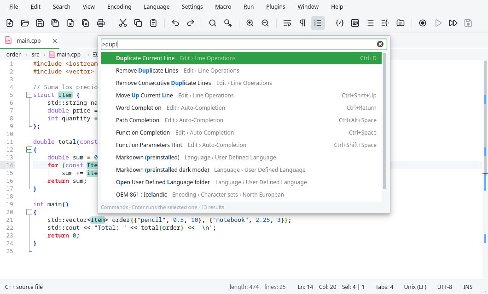

# Views and panels

## Command palette

{{actionCommandPalette}} opens a search field at the top of the window with every command of the
menus, the plugins and the macros. Type part of the name, in any order and with letters missing
(`dupl lin` finds **Duplicate Current Line**), and press Enter to run it. Each command shows its
menu and its shortcut, so the palette is also a good way to learn them.

The same field does other things depending on the first character:

| Start with | To |
|---|---|
| (nothing) | Open a file: open documents, recent files and files of the workspace folders ({{actionGoToFile}}). |
| `>` | Run a command (this is what {{actionCommandPalette}} opens). |
| `@` | Go to a symbol of the document ({{actionGoToSymbol}}). |
| `:` | Go to a line: `:120`, or `:120:5` for line and column. |

## Tabs

The **View › Tab** submenu has everything about tabs:

- {{actionNextTab}} and {{actionPreviousTab}} go to the next or previous tab; {{actionFirstTab}}
  and {{actionLastTab}}, to the first or last one; {{actionTab1}} and the following ones, to the
  tab with that number (with Ctrl and the number of the numeric keypad).
- Drag a tab to change its position, or use {{actionTabForward}}, {{actionTabBackward}},
  {{actionTabToStart}} and {{actionTabToEnd}}.
- {{actionPinTab}} pins it: pinned tabs go first, have a pin instead of the close button
  (clicking it unpins) and {{actionCloseAllButPinned}} does not close them. Dragging does not
  move a tab between the pinned ones and the others.
- {{actionTabColor1}} and the following ones mark the tab with one of five colors, to tell groups
  of documents apart; {{actionTabColorNone}} removes it.
- The session remembers which tabs are pinned and their colors.
- Right click on a tab shows a menu: close it, close the others or those on one side, move or
  clone it to the other view, save it, reload it, copy its path, name or folder, open its folder
  in the file manager or in a terminal, and make it read-only.

The General page of {{actionPreferences}} controls the tab bar: hide it, show a close button on
each tab, close a document with a double click, and the icons of the file types.

## Split view

Edita can show two documents side by side (or one above the other):

| Command | What it does |
|---|---|
| {{actionMoveToOtherView}} | Moves the current document to the other view. |
| {{actionCloneToOtherView}} | Shows the same document in both views: what you write in one appears in the other. Useful to see two parts of a long file. |
| {{actionSwitchView}} | Moves the focus to the other view. |
| {{actionOpenInNewInstance}} | Opens the document in a new Edita window, at the same line and with the same language. |
| {{actionMoveToNewInstance}} | The same, and closes it here (and this window, if it was the only document). |
| {{actionRotateSplit}} | Places the views side by side or one above the other. |

The other view closes when its last document is closed. The divider can be dragged. The new window
reads the file from disk, so the last two commands need it saved; the new window does not restore
or save the session.

With {{actionSyncScrollV}} and {{actionSyncScrollH}}, both views scroll together, keeping the
difference they had when it was turned on: useful to compare two versions of a file line by line.

## Full screen, Post-It and always on top

- {{actionFullScreen}} fills the screen; the same key goes back.
- {{actionPostIt}} leaves only the text, without frame, menus, bars or tabs, like a sticky note;
  the same key goes back.
- {{actionAlwaysOnTop}} keeps the Edita window above the others.

## Summary and monitoring

- {{actionSummary}} shows the path and dates of the file, and counts its characters (without the
  line endings), words, lines and bytes, and the selection.
- {{actionMonitoring}} follows a growing file, like a log: it becomes read-only and, each time it
  changes on disk, it is read again without asking and goes to the end, also with Edita in the
  background. To follow it, the file has to be saved.

## The Window menu

The **Window** menu lists the documents of the current view, numbered (Alt+W and the number opens
one), with a `*` on those with unsaved changes; the current one is checked.

**Sort By** orders the tabs of the current view:

| Ascending | Descending |
|---|---|
| {{item:actionSortTabsNameAsc}} | {{item:actionSortTabsNameDesc}} |
| {{item:actionSortTabsPathAsc}} | {{item:actionSortTabsPathDesc}} |
| {{item:actionSortTabsTypeAsc}} | {{item:actionSortTabsTypeDesc}} |
| {{item:actionSortTabsSizeAsc}} | {{item:actionSortTabsSizeDesc}} |
| {{item:actionSortTabsModifiedAsc}} | {{item:actionSortTabsModifiedDesc}} |

{{actionWindowsList}} opens a list of the documents of the current view with their name, path,
type and size. Click a column to sort the list by it. Select one or several documents (with Ctrl
or Shift) and:

- **Activate** (or double click) switches to the document.
- **Save** saves the selected documents that have changes.
- **Close window(s)** closes them (asking about unsaved changes).
- **Sort tabs** puts the tabs in the order of the list.

## Display options

| Command | What it does |
|---|---|
| {{actionWrap}} | Wraps the long lines to the width of the window. |
| {{actionShowWhiteSpace}} | Shows spaces as dots and tabs as arrows. |
| {{actionShowEol}} | Shows the end of line characters (CR, LF). |
| {{actionShowIndentGuides}} | Shows vertical lines at each indentation level. |
| {{actionShowWrapSymbol}} | Marks the lines that continue on the next row. |
| {{actionShowNpc}} | Shows the invisible characters that are not normal spaces (no-break space, zero-width space, direction marks…) with their abbreviation in a box: NBSP, ZWSP, RLM… |
| {{actionShowControlChars}} | Shows the control characters (NUL, ESC, the C1 ones…) and the Unicode ends of line (NEL, LS, PS) with their abbreviation; without it, they are not seen. On by default. |
| {{actionShowAll}} | Shows all of the above at once: spaces, tabs, ends of line and non-printing and control characters. |
| {{actionZoomIn}} / {{actionZoomOut}} | Makes the text larger or smaller (also Ctrl+mouse wheel). |
| {{actionZoomRestore}} | Restores the normal size. |

The Editing and Margins pages of {{actionPreferences}} have more options: highlight the current
line, the caret width and blink rate, scroll beyond the last line, the line number margin, the
bookmark margin, a vertical edge at a column (to keep lines short), the fold margin style and
the color preview of `#rrggbb` and `rgb()` colors (click the color to open a color picker).

### Breadcrumbs and sticky scroll

- **Breadcrumbs above the editor** shows the folders, the file and the class and function of the
  cursor. Click a part to open the list of files of a folder or of the symbols of the document.
  In a document over 2 MB, the class and function are updated when you come back to its tab,
  not while you type, and only when the cursor is on their first line.
- **Sticky scroll** keeps the first line of the current block (the function, the class, the
  heading) at the top of the editor while you scroll inside it.

Both are options of the Editing page.

### Marks in the scroll bar

The vertical scroll bar shows marks for the Git changes, the bookmarks, the search results, the
smart highlighting and the cursor position, so you can see where they are in the whole document
and click to go there. Turn them off with **Marks in the scroll bar** (Margins page).

## Folding

The fold margin shows a symbol at the start of each block (a function, a class, a tag, a section
of a JSON file…). Click it to fold or unfold the block.

| Command | What it does |
|---|---|
| {{actionFoldAll}} / {{actionUnfoldAll}} | Folds / unfolds every block. |
| {{actionFoldCurrent}} / {{actionUnfoldCurrent}} | Folds / unfolds the block of the cursor. |

**Fold Level** and **Unfold Level** fold or unfold all the blocks of one level: level 1 are the
outermost blocks, level 2 those inside them, and so on.

| Fold | Unfold |
|---|---|
| {{item:actionFoldLevel1}} | {{item:actionUnfoldLevel1}} |
| {{item:actionFoldLevel2}} | {{item:actionUnfoldLevel2}} |
| {{item:actionFoldLevel3}} | {{item:actionUnfoldLevel3}} |
| {{item:actionFoldLevel4}} | {{item:actionUnfoldLevel4}} |
| {{item:actionFoldLevel5}} | {{item:actionUnfoldLevel5}} |
| {{item:actionFoldLevel6}} | {{item:actionUnfoldLevel6}} |
| {{item:actionFoldLevel7}} | {{item:actionUnfoldLevel7}} |
| {{item:actionFoldLevel8}} | {{item:actionUnfoldLevel8}} |

## Hiding lines

{{actionHideLines}} hides the selected lines (or the current line), to take out of the way a part of
the document you don't need to see, without folding it. A blue triangle in the bookmark margin, on
the line above and the line below, marks where the lines are hidden; click either of them to show
the lines again. Hiding lines next to other hidden lines joins them in one section.

The first and the last line of the document cannot be hidden. The hidden lines stay hidden when you
fold and unfold, and when you switch to another document and back; the text is not changed, and
searching, copying or saving include the hidden lines.

## Panels

The panels are shown or hidden from the View menu. They can be dragged to any side of the window,
placed as tabs over each other, or detached as floating windows. When you open Edita again, every
panel is where you left it: the side, the size, whether it was floating and which panels it shared
tabs with. Plugin panels too.

### TODO

{{actionTodo}} shows the comments with **TODO**, **FIXME**, **HACK**, **XXX**, **BUG** or
**NOTE**, grouped by file. The word is in capitals, right after the comment mark (`// TODO: …`,
`# FIXME …`, `/* HACK */`, `-- NOTE`, `<!-- BUG -->`), so a `TODO_LIST` variable or a `"TODO"`
string do not count. Double-click or Enter goes to the line.

At the top you choose what to check:

- **Current document**: updated as you type.
- **Workspace folders**: every file of Folder as Workspace (or, without one, of the folder of
  the document), without hidden folders such as `.git`, nor `node_modules`. Open documents
  count with their unsaved text. The reload button searches again.

### Document List

{{actionDocumentList}} lists the open documents of both views. Click one to switch to it. It is
useful when there are too many tabs to read their names.

### Function List

{{actionFunctionList}} shows the functions, classes and methods of the current document, using
the same parsers as Notepad++ (`functionList`). Click one to go there. The field at the top
filters the list, and the buttons sort it alphabetically or reload it.

### Document Map

{{actionDocumentMap}} shows the whole document in miniature, with the visible part highlighted.
Click or drag on the map to move through the document. It also shows the Git changes, the
bookmarks and the search results.

### Folder as Workspace

{{actionFolderAsWorkspace}} shows a tree with the folders of your project. Add folders with
{{actionOpenFolderAsWorkspace}} or with the **Add folder** button of the panel. Double click a
file to open it.

The right click menu has: open, copy the path or the name, open the containing folder, **Open in
Terminal**, **Find in Files…** in that folder, reload, and remove the folder from the workspace.
The buttons at the top **locate the current file** in the tree and **collapse all**.

The **Filter** field leaves in the tree only the files that match, with their folders expanded:

- Words: each one has to be in the path, ignoring case (`src main` finds `src/main.cpp`).
- Wildcards, separated by spaces: by name, as in Find in Files (`*.cpp *.h`).

Hidden folders (such as `.git`) and `node_modules` are not checked. When you clear the filter, the
tree goes back to how it was.

In a Git repository, the panel shows the branch and colors the modified, new and ignored files.

### Search Results

The results of **Find All** and **Find in Files**; see
[The search results panel](04-search.md#the-search-results-panel).

### Problems and Terminal

{{actionProblems}} lists the errors and warnings of the language servers. {{actionTerminal}} shows
the integrated terminal and {{actionNewTerminal}} opens a new tab in it;
{{actionRunSelectionInTerminal}} sends the selected text (or the current line) to the terminal
and runs it.
See [Language servers](08-language-servers.md) and [Terminal](11-terminal.md).
