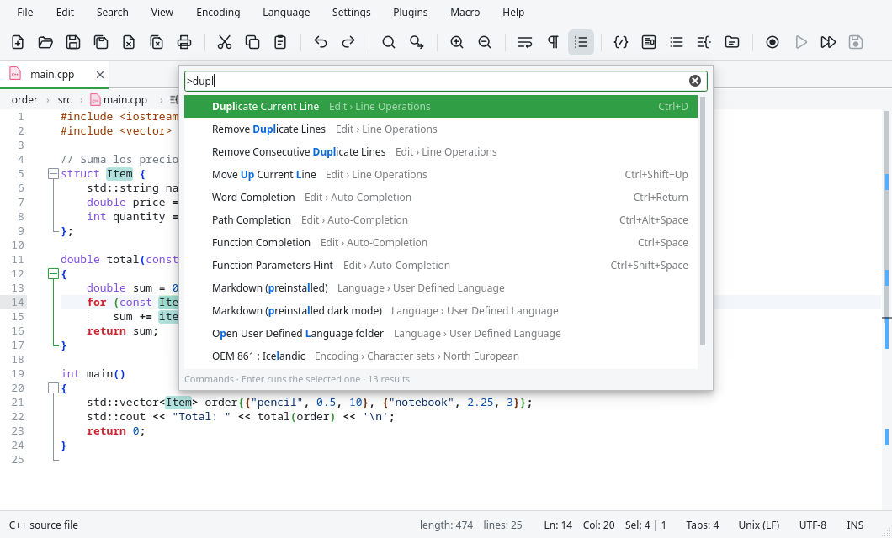

# Views and panels

## Command palette

{{actionCommandPalette}} opens a search field at the top of the window with every command of the
menus, the plugins and the macros. Type part of the name, in any order and with letters missing
(`dupl lin` finds **Duplicate Current Line**), and press Enter to run it. Each command shows its
menu and its shortcut, so the palette is also a good way to learn them.

The same field does other things depending on the first character:

| Start with | To |
|---|---|
| (nothing) | Open a file: open documents, recent files and files of the workspace folders ({{actionGoToFile}}). |
| `>` | Run a command (this is what {{actionCommandPalette}} opens). |
| `@` | Go to a symbol of the document ({{actionGoToSymbol}}). |
| `:` | Go to a line: `:120`, or `:120:5` for line and column. |

## Tabs

- {{actionNextTab}} and {{actionPreviousTab}} go to the next or previous tab.
- Drag a tab to change its position.
- Right click on a tab shows a menu: close it, close the others or those on one side, move or
  clone it to the other view, save it, reload it, copy its path, name or folder, open its folder
  in the file manager or in a terminal, and make it read-only.

The General page of {{actionPreferences}} controls the tab bar: hide it, show a close button on
each tab, close a document with a double click, and the icons of the file types.

## Split view

Edita can show two documents side by side (or one above the other):

| Command | What it does |
|---|---|
| {{actionMoveToOtherView}} | Moves the current document to the other view. |
| {{actionCloneToOtherView}} | Shows the same document in both views: what you write in one appears in the other. Useful to see two parts of a long file. |
| {{actionSwitchView}} | Moves the focus to the other view. |
| {{actionRotateSplit}} | Places the views side by side or one above the other. |

The other view closes when its last document is closed. The divider can be dragged.

## Display options

| Command | What it does |
|---|---|
| {{actionWrap}} | Wraps the long lines to the width of the window. |
| {{actionShowWhiteSpace}} | Shows spaces as dots and tabs as arrows. |
| {{actionShowEol}} | Shows the end of line characters (CR, LF). |
| {{actionShowIndentGuides}} | Shows vertical lines at each indentation level. |
| {{actionShowWrapSymbol}} | Marks the lines that continue on the next row. |
| {{actionShowAll}} | Shows spaces, tabs and ends of line at once. |
| {{actionZoomIn}} / {{actionZoomOut}} | Makes the text larger or smaller (also Ctrl+mouse wheel). |
| {{actionZoomRestore}} | Restores the normal size. |

The Editing and Margins pages of {{actionPreferences}} have more options: highlight the current
line, the caret width and blink rate, scroll beyond the last line, the line number margin, the
bookmark margin, a vertical edge at a column (to keep lines short), the fold margin style and
the color preview of `#rrggbb` and `rgb()` colors (click the color to open a color picker).

### Breadcrumbs and sticky scroll

- **Breadcrumbs above the editor** shows the folders, the file and the class and function of the
  cursor. Click a part to open the list of files of a folder or of the symbols of the document.
- **Sticky scroll** keeps the first line of the current block (the function, the class, the
  heading) at the top of the editor while you scroll inside it.

Both are options of the Editing page.

### Marks in the scroll bar

The vertical scroll bar shows marks for the Git changes, the bookmarks, the search results, the
smart highlighting and the cursor position, so you can see where they are in the whole document
and click to go there. Turn them off with **Marks in the scroll bar** (Margins page).

## Folding

The fold margin shows a symbol at the start of each block (a function, a class, a tag, a section
of a JSON file…). Click it to fold or unfold the block.

| Command | What it does |
|---|---|
| {{actionFoldAll}} / {{actionUnfoldAll}} | Folds / unfolds every block. |
| {{actionFoldCurrent}} / {{actionUnfoldCurrent}} | Folds / unfolds the block of the cursor. |

**Fold Level** and **Unfold Level** fold or unfold all the blocks of one level: level 1 are the
outermost blocks, level 2 those inside them, and so on.

| Fold | Unfold |
|---|---|
| {{item:actionFoldLevel1}} | {{item:actionUnfoldLevel1}} |
| {{item:actionFoldLevel2}} | {{item:actionUnfoldLevel2}} |
| {{item:actionFoldLevel3}} | {{item:actionUnfoldLevel3}} |
| {{item:actionFoldLevel4}} | {{item:actionUnfoldLevel4}} |
| {{item:actionFoldLevel5}} | {{item:actionUnfoldLevel5}} |
| {{item:actionFoldLevel6}} | {{item:actionUnfoldLevel6}} |
| {{item:actionFoldLevel7}} | {{item:actionUnfoldLevel7}} |
| {{item:actionFoldLevel8}} | {{item:actionUnfoldLevel8}} |

## Hiding lines

{{actionHideLines}} hides the selected lines (or the current line), to take out of the way a part of
the document you don't need to see, without folding it. A blue triangle in the bookmark margin, on
the line above and the line below, marks where the lines are hidden; click either of them to show
the lines again. Hiding lines next to other hidden lines joins them in one section.

The first and the last line of the document cannot be hidden. The hidden lines stay hidden when you
fold and unfold, and when you switch to another document and back; the text is not changed, and
searching, copying or saving include the hidden lines.

## Panels

The panels are shown or hidden from the View menu. They can be dragged to any side of the window,
placed as tabs over each other, or detached as floating windows. Edita remembers where they were.

### Document List

{{actionDocumentList}} lists the open documents of both views. Click one to switch to it. It is
useful when there are too many tabs to read their names.

### Function List

{{actionFunctionList}} shows the functions, classes and methods of the current document, using
the same parsers as Notepad++ (`functionList`). Click one to go there. The field at the top
filters the list, and the buttons sort it alphabetically or reload it.

### Document Map

{{actionDocumentMap}} shows the whole document in miniature, with the visible part highlighted.
Click or drag on the map to move through the document. It also shows the Git changes, the
bookmarks and the search results.

### Folder as Workspace

{{actionFolderAsWorkspace}} shows a tree with the folders of your project. Add folders with
{{actionOpenFolderAsWorkspace}} or with the **Add folder** button of the panel. Double click a
file to open it.

The right click menu has: open, copy the path or the name, open the containing folder, **Open in
Terminal**, **Find in Files…** in that folder, reload, and remove the folder from the workspace.
The buttons at the top **locate the current file** in the tree and **collapse all**.

In a Git repository, the panel shows the branch and colors the modified, new and ignored files.

### Search Results

The results of **Find All** and **Find in Files**; see
[The search results panel](04-search.md#the-search-results-panel).

### Problems and Terminal

{{actionProblems}} lists the errors and warnings of the language servers. {{actionTerminal}} shows
the integrated terminal and {{actionNewTerminal}} opens a new tab in it;
{{actionRunSelectionInTerminal}} sends the selected text (or the current line) to the terminal
and runs it.
See [Language servers](08-language-servers.md) and [Terminal](11-terminal.md).
