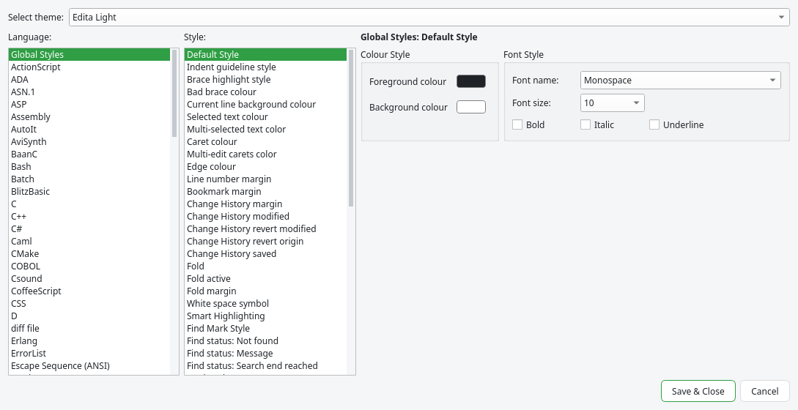

# Languages and themes

## Syntax highlighting

Edita colors more than 90 languages, with the same definitions as Notepad++. The language of a
document is chosen when it is opened, from its extension or its file name (`Makefile`,
`CMakeLists.txt`…), and in some cases from its first line (`#!/bin/bash`, `<?xml`). The status
bar shows it.

To change it, choose another one in the **Language** menu (grouped by initial) or click the
language field of the status bar, which opens a list with a search field.
{{actionLang0}} turns the highlighting off.

Each language defines more than colors: the comment symbols used by {{actionToggleComment}},
the words of the autocompletion, the folding, and the parser of the Function List.

## User defined languages

When a language is not included, you can define it: its keywords, comments, numbers, operators,
delimiters (such as strings), folding and colors. The files are compatible with the
`userDefineLang.xml` of Notepad++, so the many definitions that exist for it can be used here.

- {{actionDefineLanguage}} opens the editor of user defined languages.
- **Language › User Defined Language › Import…** adds the definitions of an XML file.
- **Open User Defined Language folder** opens `~/.config/edita/userDefineLangs/`, where each
  language is a file.

Edita includes Markdown (in a light and a dark variant). The user defined languages are chosen
by extension before the built-in ones.

### The editor of user defined languages

At the top, choose the language to edit. **Create New…**, **Save As…**, **Rename…** and
**Remove** manage the languages, and **Import…** and **Export…** read or write them as XML
files. **Ext.** sets the extensions (separated by spaces, without dot) that use this language.
The tabs:

| Tab | What it defines |
|---|---|
| Folder & Default | The words or symbols that open and close a fold block (in code and in comments), and the default style. |
| Keywords Lists | Eight groups of words, each with its own style. With **Prefix mode**, a word matches when it starts with one of the list. |
| Comment & Number | Line and block comments, and how numbers are written: prefixes (`0x`), suffixes, ranges and decimal separator. |
| Operators & Delimiter | Operators, and up to eight delimiters (for example `"` … `"` for strings) with an escape character. |
| Styles | The color, background, font and nesting of each element. |

Click **Save** to apply the changes: the documents with that language are colored again.

## Appearance and themes

Edita has a light and a dark mode. **Appearance** in the General page of {{actionPreferences}}
chooses light, dark or **Follow the system** (the default), which changes at the same moment the
desktop changes. The welcome page has the same choice.

The colors of the text come from a **theme**. The **View › Theme** menu lists them: the default
one, Edita Light and Edita Dark, the themes of Notepad++ (Monokai, Solarized, Zenburn…) and
modern themes such as One Dark, Dracula, Catppuccin, Nord and Tokyo Night. Each mode has its own
theme: the one you choose is used for the current mode, and when the mode changes, the theme of
the other mode comes back.

The same menu has:

- {{actionReloadSyntax}}: reads the configuration files again, after editing them by hand.
- **Edit the Styles File** and **Edit langs.xml**: open the files of the current theme and of the
  languages, to edit them as text.

Edita uses the monospaced font of the system instead of the Windows fonts that many themes ask
for (Courier New, Consolas). Turn off **Use the system monospace font** in the Editing page to use
the font of the theme.

## Style Configurator

{{actionStyleConfigurator}} changes the colors and fonts of a theme without editing XML:

- **Theme**: the theme to edit (choosing one also applies it).
- **Language**: **Global Styles** (the default text, the current line, the selection, the
  margins, the matching braces, the token styles…) or a language.
- **Style**: an element of the language (keyword, comment, string…).
- On the right: the text and background colors, the font, the size, bold, italic and underline.
  The colors that a style does not use are disabled.
- For a language, its **extensions** and the **user extensions** that also use it. For the
  styles with keywords, **user-defined keywords** to add your own words.
- **Global override** (in Global Styles) forces a font, size or color on every style.

The changes are previewed in the editor and saved with **Save & Close**. A theme installed with
Edita is copied first to `~/.config/edita/themes/`, and the copy replaces it.
