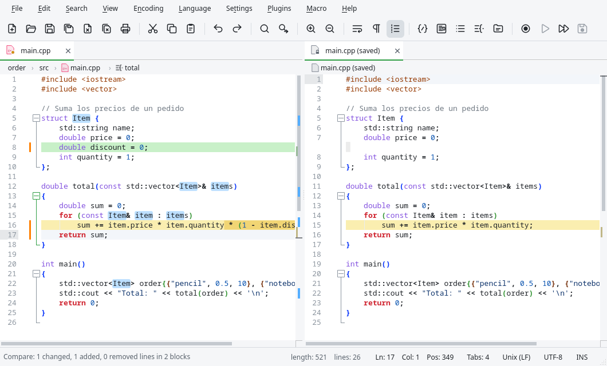

# Comparing documents

Edita can show two documents side by side with their differences highlighted, like the Compare
plugin of Notepad++.

## Starting a comparison

| Command | Compares |
|---|---|
| {{actionCompareViews}} | The documents of the two views. With a single view and several tabs, the current document is moved to the other view and compared with the previous one. |
| {{actionCompareSaved}} | The document with its last saved version: what you changed since you saved. |
| {{actionCompareGit}} | The document with its version of the last Git commit. |

The saved and the Git versions are opened in the other view as read-only documents named
`main.cpp (saved)` or `main.cpp (HEAD)`; they are closed when the comparison ends.

## Reading the differences

- **Green**: lines added in the right document.
- **Red**: lines removed (they are in the left document only).
- **Yellow**: lines changed; inside them, the characters that differ are highlighted.

Where one side has lines that the other lacks, empty space is added so that equal lines stay at
the same height. Both views scroll together, vertically and horizontally. The differences are
also marked in the scroll bar, and the status bar sums them up:
"Compare: 3 changed, 2 added, 2 removed lines in 4 blocks", or that the documents are identical.

You can keep editing either document: the comparison is updated a moment after each change.

| Command | What it does |
|---|---|
| {{actionNextDifference}} / {{actionPreviousDifference}} | Goes to the next / previous block of differences. While comparing, {{key:actionNextChange}} and {{key:actionPreviousChange}} do the same. |
| {{actionCompareIgnoreSpaces}} | Lines that only differ in spaces are considered equal. |
| {{actionCompareIgnoreCase}} | Lines that only differ in uppercase and lowercase are considered equal. |
| {{actionCompareClear}} | Ends the comparison and removes the colors. |

The comparison also ends when you switch tabs in one of the views or close one of the documents.
