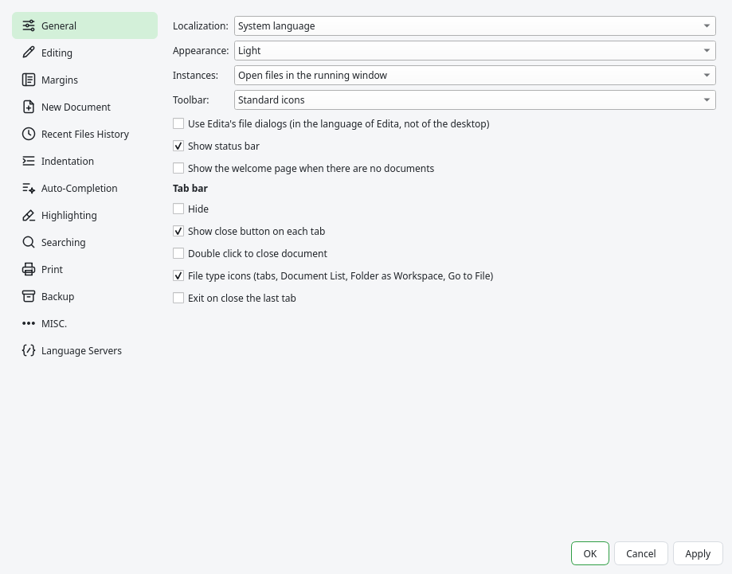

# Preferences and shortcuts

## Preferences

{{actionPreferences}} groups the options in pages. The changes are applied when you click OK.
Most options are described in the chapter of their feature; this is a summary.

| Page | Options |
|---|---|
| General | Language of the interface (it changes after restarting), appearance (light, dark or follow the system), instances, Edita's file dialogs, status bar, welcome page, and the tab bar. |
| Toolbar | Hiding it and the size of its icons. |
| Editing | Current line highlight, caret, multi-editing, virtual space, scroll beyond the last line, copy the line without selection, the system monospace font, show spaces and ends of line, indent guides, color preview, colored brackets, breadcrumbs, sticky scroll and line wrap. |
| Margins | Line numbers, fold margin style, vertical edge, bookmark margin, change history, current line number, Git changes, Git in the explorer, blame and marks in the scroll bar. |
| New Document | End of line, encoding and language of new documents, and the folder of the open and save dialogs. |
| Recent Files History | Number of recent files, submenu and how their names are shown. |
| Indentation | Tab size, tabs or spaces, Backspace unindents and auto-indent, for all the languages or for each one. |
| Language | The Language menu compact (grouped by initial) or with all of them in a row, the languages left out of it, and whether the backslash escapes characters in SQL. |
| Auto-Completion | When to show the list, from how many characters, snippets with Tab, parameter hints and the automatic closing of brackets, quotes and tags. |
| Highlighting | Smart highlighting and its options, matching HTML/XML tags, and the options of the token styles. |
| Searching | The inline find bar, filling the search field with the selection, the confirmation of Replace All in all documents and the font of the Find dialog. |
| Print | Line numbers, colors, page breaks, margins, header and footer. |
| Backup | Session, snapshot mode, the backup of the previous version on save and the extension of session files. |
| Delimiter | The characters that are also part of a word (for double-click, "match whole word only", smart highlighting…) and the delimiters of Ctrl+double-click, on one line or on several. |
| Performance | From which size a file is large (200 MB by default): it opens without colors and, unless allowed, without auto-completion, smart highlighting, brace match or links; and whether word wrap is turned off when opening it. |
| Cloud & Link | A folder (a synchronized one, for example) to keep all the settings, used after restarting; and the links: whether they are marked, underlined or not, with a box when the mouse is over them, and other schemes besides http, https, ftp, file and mailto. |
| Search Engine | The search engine of **Edit › On Selection › Search on Internet**. |
| MISC. | Detection of changes made by other programs, encoding detection, default character set, the shell of the terminal and checking for new versions of Edita at startup. |
| Language Servers | Turning them on or off, the hints at the end of the lines and the command of each server. |
| Formatting | Format on save and the formatting tool of each language (see [Formatting](03-editing.md#formatting)). |
| Spelling | The spell checker, its dictionaries and whether only comments and strings are checked in code (see [Spelling](03-editing.md#spelling)). |

## Shortcut Mapper

{{actionShortcutMapper}} changes the keyboard shortcuts. Its tabs:

- **Main menu**: every menu command, with its menu as category.
- **Macros**: the saved macros.
- **Run commands**: the commands saved in the [Run menu](12-macros.md#the-run-menu).
- **Plugin commands**: the commands of the plugins.
- **Scintilla commands**: the keys of the editor itself (move by words, delete lines, select…).

Type in the filter to find a command. **Modify** (or a double click) asks for the new key
combination: press it. **Clear** removes the shortcut, and **Delete** removes a macro. The changes
are applied and saved at once. If the combination is already used by another command, Edita warns
and offers to take it from that command.

The shortcuts are saved in `~/.config/edita/shortcuts.xml` with the format of Notepad++ (only the
ones that differ from the default). This manual always shows the current shortcuts.

## The context menu

The menu of the right click in the editor is the one of `contextMenu.xml`, with the same format as
in Notepad++ (at first it has the default one of Notepad++). {{actionEditContextMenu}} opens it to
change it; the changes appear the next time the menu opens, after saving. Each `<Item>` is a
command:

- `id="42001"`: by its Notepad++ number; `id="0"` is a separator.
- `MenuEntryName="Edit" MenuItemName="Cut"`: by its menu and its English name (those of
  Notepad++), or with the names of Edita's menus in the language you use.
- `PluginEntryName="MIME Tools" PluginCommandItemName="Base64 Encode"`: a command of a plugin.
- `FolderName="…"` puts it in a submenu, and `ItemNameAs="…"` gives it another name.

Whatever Edita does not have, or plugins that are not installed, do not appear.

The menu of the tabs works the same way with `tabContextMenu.xml` (inside `<TabContextMenu>`), as in
Notepad++, but only while that file exists: without it, Edita uses its own tab menu.
{{actionEditTabContextMenu}} creates it the first time (with the example of Notepad++) and opens
it. To get the usual menu back, delete the file.

## Configuration files

Edita keeps its configuration in `~/.config/edita/` (on macOS, without `XDG_CONFIG_HOME`,
`~/Library/Preferences/edita/`). The files have the same format as those of Notepad++:

| File or folder | Contents |
|---|---|
| `config.xml` | The preferences. |
| `session.xml` | The documents of the last session. |
| `langs.xml` | The languages: extensions, keywords and comment symbols. |
| `stylers.xml`, `themes/` | The default theme and the themes you changed. |
| `shortcuts.xml` | Shortcuts and macros. |
| `contextMenu.xml` | The menu of the right click in the editor. |
| `tabContextMenu.xml` | The menu of the right click on the tabs (optional). |
| `personalDictionary.txt` | The words you added to the dictionary. |
| `userDefineLang.xml`, `userDefineLangs/` | The user defined languages. |
| `autoCompletion/` | Your API files for autocompletion. |
| `snippets/` | Your snippets. |
| `backup/` | The copies of unsaved documents (snapshot mode). |
| `plugins/` | Installed plugins and their configuration. |

To start with the default configuration, close Edita and rename the folder. To keep several
independent configurations, start Edita with another `XDG_CONFIG_HOME`.
