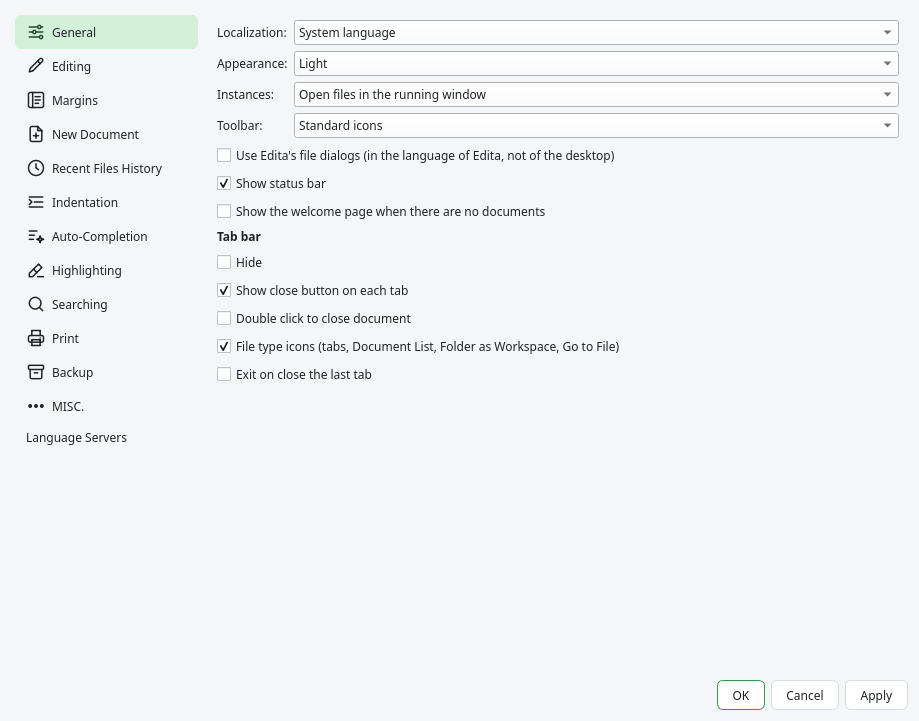

# Preferences and shortcuts

## Preferences

{{actionPreferences}} groups the options in pages. The changes are applied when you click OK.
Most options are described in the chapter of their feature; this is a summary.

| Page | Options |
|---|---|
| General | Language of the interface (it changes after restarting), appearance (light, dark or follow the system), instances, toolbar, Edita's file dialogs, status bar, welcome page, and the tab bar. |
| Editing | Current line highlight, caret, multi-editing, virtual space, scroll beyond the last line, copy the line without selection, the system monospace font, show spaces and ends of line, indent guides, color preview, colored brackets, breadcrumbs, sticky scroll and line wrap. |
| Margins | Line numbers, fold margin style, vertical edge, bookmark margin, change history, current line number, Git changes, Git in the explorer, blame and marks in the scroll bar. |
| New Document | End of line, encoding and language of new documents, and the folder of the open and save dialogs. |
| Recent Files History | Number of recent files, submenu and how their names are shown. |
| Indentation | Tab size, tabs or spaces, Backspace unindents and auto-indent, for all the languages or for each one. |
| Auto-Completion | When to show the list, from how many characters, snippets with Tab, parameter hints and the automatic closing of brackets, quotes and tags. |
| Highlighting | Smart highlighting and its options, matching HTML/XML tags, and the options of the token styles. |
| Searching | The inline find bar, filling the search field with the selection, the confirmation of Replace All in all documents and the font of the Find dialog. |
| Print | Line numbers, colors, page breaks, margins, header and footer. |
| Backup | Session, snapshot mode, the backup of the previous version on save and the extension of session files. |
| MISC. | Detection of changes made by other programs, encoding detection, default character set and the shell of the terminal. |
| Language Servers | Turning them on or off, the hints at the end of the lines and the command of each server. |

## Shortcut Mapper

{{actionShortcutMapper}} changes the keyboard shortcuts. Its tabs:

- **Main menu**: every menu command, with its menu as category.
- **Macros**: the saved macros.
- **Plugin commands**: the commands of the plugins.
- **Scintilla commands**: the keys of the editor itself (move by words, delete lines, select…).

Type in the filter to find a command. **Modify** (or a double click) asks for the new key
combination: press it. **Clear** removes the shortcut, and **Delete** removes a macro. The changes
are applied and saved at once. If the combination is already used by another command, Edita warns
and offers to take it from that command.

The shortcuts are saved in `~/.config/edita/shortcuts.xml` with the format of Notepad++ (only the
ones that differ from the default). This manual always shows the current shortcuts.

## Configuration files

Edita keeps its configuration in `~/.config/edita/` (on macOS, without `XDG_CONFIG_HOME`,
`~/Library/Preferences/edita/`). The files have the same format as those of Notepad++:

| File or folder | Contents |
|---|---|
| `config.xml` | The preferences. |
| `session.xml` | The documents of the last session. |
| `langs.xml` | The languages: extensions, keywords and comment symbols. |
| `stylers.xml`, `themes/` | The default theme and the themes you changed. |
| `shortcuts.xml` | Shortcuts and macros. |
| `userDefineLang.xml`, `userDefineLangs/` | The user defined languages. |
| `autoCompletion/` | Your API files for autocompletion. |
| `snippets/` | Your snippets. |
| `backup/` | The copies of unsaved documents (snapshot mode). |
| `plugins/` | Installed plugins and their configuration. |

To start with the default configuration, close Edita and rename the folder. To keep several
independent configurations, start Edita with another `XDG_CONFIG_HOME`.
