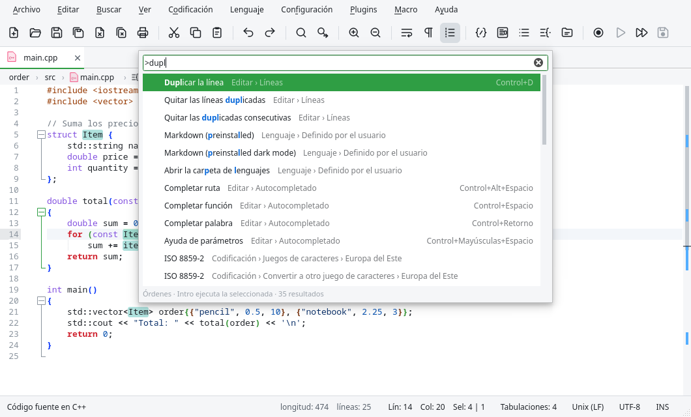

# Vistas y paneles

## Paleta de órdenes

{{actionCommandPalette}} abre un campo de búsqueda arriba de la ventana con todas las órdenes de
los menús, de los plugins y de las macros. Escribe parte del nombre, en cualquier orden y aunque
falten letras (`dupl lin` encuentra **Duplicar la línea**), y pulsa Intro para ejecutarla. Cada
orden muestra su menú y su atajo, así que la paleta también sirve para aprenderlos.

El mismo campo hace otras cosas según el primer carácter:

| Empieza con | Para |
|---|---|
| (nada) | Abrir un archivo: documentos abiertos, recientes y archivos de las carpetas de trabajo ({{actionGoToFile}}). |
| `>` | Ejecutar una orden (es lo que abre {{actionCommandPalette}}). |
| `@` | Ir a un símbolo del documento ({{actionGoToSymbol}}). |
| `:` | Ir a una línea: `:120`, o `:120:5` para línea y columna. |

## Pestañas

- {{actionNextTab}} y {{actionPreviousTab}} van a la pestaña siguiente o anterior.
- Arrastra una pestaña para cambiarla de lugar.
- El clic derecho en una pestaña muestra un menú: cerrarla, cerrar las demás o las de un lado,
  moverla o clonarla en la otra vista, guardarla, volver a cargarla, copiar su ruta, su nombre o
  su carpeta, abrir su carpeta en el administrador de archivos o en una terminal, y hacerla de
  solo lectura.

La página General de {{actionPreferences}} controla la barra de pestañas: ocultarla, mostrar un
botón de cerrar en cada pestaña, cerrar un documento con doble clic y los iconos por tipo de
archivo.

## Vista dividida

Edita puede mostrar dos documentos uno al lado del otro (o uno encima del otro):

| Orden | Qué hace |
|---|---|
| {{actionMoveToOtherView}} | Mueve el documento actual a la otra vista. |
| {{actionCloneToOtherView}} | Muestra el mismo documento en las dos vistas: lo que escribes en una aparece en la otra. Sirve para ver dos partes de un archivo largo. |
| {{actionSwitchView}} | Pasa el foco a la otra vista. |
| {{actionRotateSplit}} | Pone las vistas una al lado de la otra o una encima de la otra. |

La otra vista se cierra cuando se cierra su último documento. La división se puede arrastrar.

## Opciones de visualización

| Orden | Qué hace |
|---|---|
| {{actionWrap}} | Ajusta las líneas largas al ancho de la ventana. |
| {{actionShowWhiteSpace}} | Muestra los espacios como puntos y las tabulaciones como flechas. |
| {{actionShowEol}} | Muestra los caracteres de fin de línea (CR, LF). |
| {{actionShowIndentGuides}} | Muestra líneas verticales en cada nivel de sangría. |
| {{actionShowWrapSymbol}} | Marca las líneas que siguen en la fila siguiente. |
| {{actionShowAll}} | Muestra espacios, tabulaciones y fines de línea a la vez. |
| {{actionZoomIn}} / {{actionZoomOut}} | Agranda o achica el texto (también Ctrl+rueda del ratón). |
| {{actionZoomRestore}} | Vuelve al tamaño normal. |

Las páginas Edición y Márgenes de {{actionPreferences}} tienen más opciones: resaltar la línea
actual, el grosor y el parpadeo del cursor, desplazar más allá de la última línea, el margen de
los números de línea, el de los marcadores, una línea vertical en una columna (para no escribir
líneas demasiado largas), el estilo del margen de plegado y la vista previa de colores
`#rrggbb` y `rgb()` (pulsa el color para abrir un selector de color).

### Ruta de navegación y encabezado fijo

- **Ruta de navegación encima del editor** muestra las carpetas, el archivo y la clase y la
  función del cursor. Pulsa una parte para abrir la lista de archivos de una carpeta o la de los
  símbolos del documento.
- **Encabezado fijo** deja la primera línea del bloque actual (la función, la clase, el
  encabezado) arriba del editor mientras te desplazas dentro de él.

Las dos son casillas de la página Edición.

### Marcas en la barra de desplazamiento

La barra de desplazamiento vertical muestra marcas de los cambios de Git, los marcadores, los
resultados de búsqueda, el resaltado inteligente y la posición del cursor, para ver dónde están
en todo el documento y pulsar para ir ahí. Se desactivan con **Marcas en la barra de
desplazamiento** (página Márgenes).

## Plegado

El margen de plegado muestra un símbolo al principio de cada bloque (una función, una clase, una
etiqueta, una sección de un archivo JSON…). Púlsalo para plegar o desplegar el bloque.

| Orden | Qué hace |
|---|---|
| {{actionFoldAll}} / {{actionUnfoldAll}} | Pliega / despliega todos los bloques. |
| {{actionFoldCurrent}} / {{actionUnfoldCurrent}} | Pliega / despliega el bloque del cursor. |

**Plegar el nivel** y **Desplegar el nivel** pliegan o despliegan todos los bloques de un nivel:
el nivel 1 son los bloques exteriores, el 2 los que están dentro de ellos, y así sucesivamente.

| Plegar | Desplegar |
|---|---|
| {{item:actionFoldLevel1}} | {{item:actionUnfoldLevel1}} |
| {{item:actionFoldLevel2}} | {{item:actionUnfoldLevel2}} |
| {{item:actionFoldLevel3}} | {{item:actionUnfoldLevel3}} |
| {{item:actionFoldLevel4}} | {{item:actionUnfoldLevel4}} |
| {{item:actionFoldLevel5}} | {{item:actionUnfoldLevel5}} |
| {{item:actionFoldLevel6}} | {{item:actionUnfoldLevel6}} |
| {{item:actionFoldLevel7}} | {{item:actionUnfoldLevel7}} |
| {{item:actionFoldLevel8}} | {{item:actionUnfoldLevel8}} |

## Ocultar líneas

{{actionHideLines}} oculta las líneas seleccionadas (o la línea actual), para quitar de en medio una
parte del documento que no necesitas ver, sin plegarla. Un triángulo azul en el margen de los
marcadores, en la línea de arriba y en la de abajo, marca dónde están las líneas ocultas; pulsa
cualquiera de los dos para volver a mostrarlas. Ocultar líneas junto a otras ocultas las une en una
sola sección.

La primera y la última línea del documento no se pueden ocultar. Las líneas ocultas siguen ocultas
al plegar y desplegar, y al cambiar a otro documento y volver; el texto no cambia, y al buscar,
copiar o guardar se incluyen las líneas ocultas.

## Paneles

Los paneles se muestran u ocultan desde el menú Ver. Se pueden arrastrar a cualquier lado de la
ventana, ponerse como pestañas uno encima de otro o separarse como ventanas flotantes. Edita
recuerda dónde estaban.

### Lista de documentos

{{actionDocumentList}} muestra los documentos abiertos de las dos vistas. Pulsa uno para cambiar
a él. Es útil cuando hay tantas pestañas que no se leen sus nombres.

### Lista de funciones

{{actionFunctionList}} muestra las funciones, clases y métodos del documento actual, con los
mismos analizadores que Notepad++ (`functionList`). Pulsa uno para ir ahí. El campo de arriba
filtra la lista, y los botones la ordenan alfabéticamente o la vuelven a cargar.

### Mapa del documento

{{actionDocumentMap}} muestra todo el documento en miniatura, con la parte visible resaltada.
Pulsa o arrastra sobre el mapa para moverte por el documento. También muestra los cambios de
Git, los marcadores y los resultados de búsqueda.

### Explorador de carpetas

{{actionFolderAsWorkspace}} muestra un árbol con las carpetas de tu proyecto. Añade carpetas con
{{actionOpenFolderAsWorkspace}} o con el botón **Añadir carpeta** del panel. Doble clic en un
archivo lo abre.

El menú del clic derecho tiene: abrir, copiar la ruta o el nombre, abrir la carpeta que lo
contiene, **Abrir en la terminal**, **Buscar en archivos…** en esa carpeta, volver a cargar y
quitar la carpeta del espacio de trabajo. Los botones de arriba **localizan el archivo actual**
en el árbol y **pliegan todo**.

En un repositorio de Git, el panel muestra la rama y colorea los archivos modificados, nuevos e
ignorados.

### Resultados de búsqueda

Los resultados de **Buscar todo** y de **Buscar en archivos**; ver
[El panel de resultados](04-search.md#el-panel-de-resultados).

### Problemas y Terminal

{{actionProblems}} muestra los errores y avisos de los servidores de lenguaje. {{actionTerminal}}
muestra la terminal integrada y {{actionNewTerminal}} abre una pestaña nueva en ella;
{{actionRunSelectionInTerminal}} envía el texto seleccionado (o la línea actual) a la terminal y
lo ejecuta.
Ver [Servidores de lenguaje](08-language-servers.md) y [Terminal](11-terminal.md).
