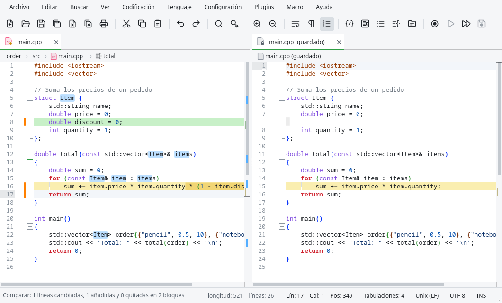

# Comparar documentos

Edita puede mostrar dos documentos uno al lado del otro con sus diferencias resaltadas, como el
plugin Compare de Notepad++.

## Empezar una comparación

| Orden | Compara |
|---|---|
| {{actionCompareViews}} | Los documentos de las dos vistas. Con una sola vista y varias pestañas, el documento actual pasa a la otra vista y se compara con el anterior. |
| {{actionCompareSaved}} | El documento con su última versión guardada: lo que cambiaste desde que guardaste. |
| {{actionCompareGit}} | El documento con su versión del último commit de Git. |

La versión guardada y la de Git se abren en la otra vista como documentos de solo lectura llamados
`main.cpp (guardado)` o `main.cpp (HEAD)`; se cierran al terminar la comparación.

## Leer las diferencias

- **Verde**: líneas añadidas en el documento de la derecha.
- **Rojo**: líneas quitadas (solo están en el documento de la izquierda).
- **Amarillo**: líneas cambiadas; dentro de ellas se resaltan los caracteres distintos.

Donde a un lado le faltan líneas que el otro tiene, se añade espacio en blanco para que las líneas
iguales queden a la misma altura. Las dos vistas se desplazan juntas, en vertical y en horizontal.
Las diferencias también se marcan en la barra de desplazamiento, y la barra de estado las resume:
«Comparar: 3 líneas cambiadas, 2 añadidas y 2 quitadas en 4 bloques», o que los documentos son
idénticos.

Puedes seguir editando cualquiera de los dos documentos: la comparación se actualiza un momento
después de cada cambio.

| Orden | Qué hace |
|---|---|
| {{actionNextDifference}} / {{actionPreviousDifference}} | Va al bloque de diferencias siguiente / anterior. Mientras se compara, {{key:actionNextChange}} y {{key:actionPreviousChange}} hacen lo mismo. |
| {{actionCompareIgnoreSpaces}} | Las líneas que solo difieren en los espacios se consideran iguales. |
| {{actionCompareIgnoreCase}} | Las líneas que solo difieren en mayúsculas y minúsculas se consideran iguales. |
| {{actionCompareClear}} | Termina la comparación y quita los colores. |

La comparación también termina al cambiar de pestaña en una de las vistas o al cerrar uno de los
documentos.
