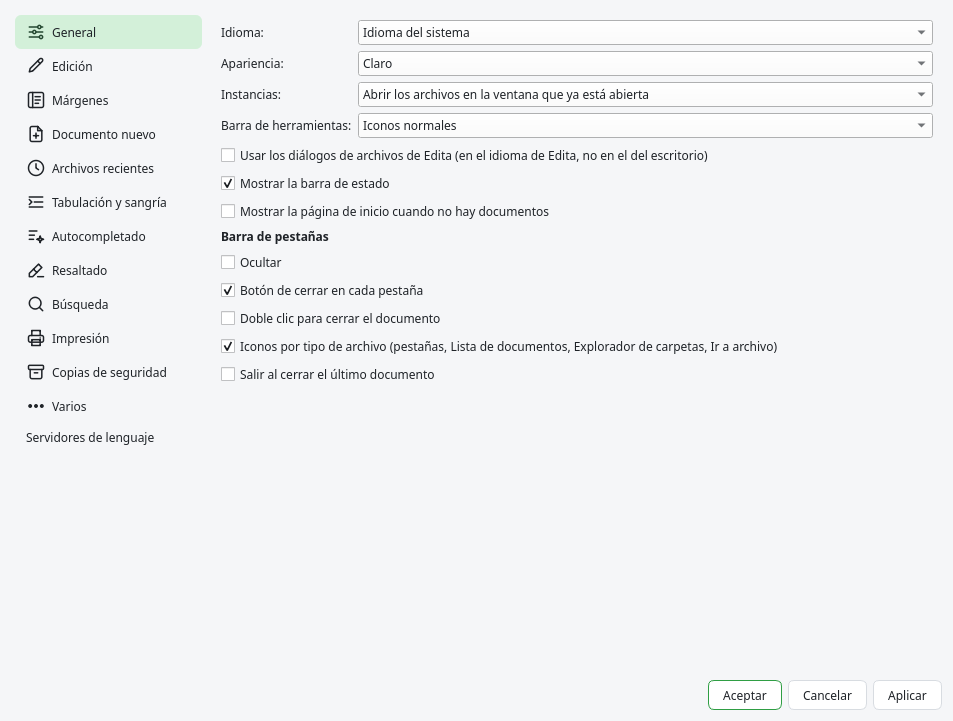

# Preferencias y atajos

## Preferencias

{{actionPreferences}} agrupa las opciones en páginas. Los cambios se aplican al pulsar Aceptar. La
mayoría de las opciones se describen en el capítulo de su función; esto es un resumen.

| Página | Opciones |
|---|---|
| General | Idioma de la interfaz (cambia al reiniciar), apariencia (claro, oscuro o seguir al sistema), instancias, barra de herramientas, diálogos de archivos de Edita, barra de estado, página de inicio y barra de pestañas. |
| Edición | Resaltado de la línea actual, cursor, edición múltiple, espacio virtual, desplazar más allá de la última línea, copiar la línea sin selección, letra monoespaciada del sistema, mostrar espacios y fines de línea, guías de sangría, vista previa de colores, paréntesis por colores, ruta de navegación, encabezado fijo y ajuste de línea. |
| Márgenes | Números de línea, estilo del plegado, líneas de margen, margen de marcadores, historial de cambios, número de la línea actual, cambios de Git, Git en el explorador, blame y marcas en la barra de desplazamiento. |
| Documento nuevo | Fin de línea, codificación y lenguaje de los documentos nuevos, y la carpeta de los diálogos de abrir y guardar. |
| Archivos recientes | Número de archivos recientes, submenú y cómo se muestran sus nombres. |
| Tabulación y sangría | Ancho de tabulación, tabulaciones o espacios, Retroceso quita sangría y sangría automática, para todos los lenguajes o para cada uno. |
| Autocompletado | Cuándo mostrar la lista, a partir de cuántos caracteres, fragmentos con Tab, ayuda de parámetros y el cierre automático de paréntesis, comillas y etiquetas. |
| Resaltado | Resaltado inteligente y sus opciones, etiqueta HTML/XML pareja y las opciones de los estilos de token. |
| Búsqueda | La barra de buscar en línea, rellenar el campo de búsqueda con la selección, la confirmación de Reemplazar todo en todos los documentos y la fuente del diálogo Buscar. |
| Impresión | Números de línea, colores, saltos de página, márgenes, cabecera y pie. |
| Copias de seguridad | Sesión, modo snapshot, la copia de la versión anterior al guardar y la extensión de los archivos de sesión. |
| Varios | Detección de cambios hechos por otros programas, detección de la codificación, juego de caracteres por defecto y la shell de la terminal. |
| Servidores de lenguaje | Activarlos o desactivarlos, las pistas al final de las líneas y la orden de cada servidor. |

## Asignación de atajos

{{actionShortcutMapper}} cambia los atajos de teclado. Sus pestañas:

- **Menú principal**: todas las órdenes de los menús, con su menú como categoría.
- **Macros**: las macros guardadas.
- **Órdenes de Ejecutar**: las órdenes guardadas en el [menú Ejecutar](12-macros.md#el-menu-ejecutar).
- **Órdenes de plugins**: las órdenes de los plugins.
- **Órdenes de Scintilla**: las teclas del propio editor (moverse por palabras, borrar líneas,
  seleccionar…).

Escribe en el filtro para encontrar una orden. **Modificar** (o un doble clic) pide la combinación
nueva: púlsala. **Borrar** quita el atajo, y **Eliminar** quita una macro. Los cambios se aplican y
se guardan al momento. Si otra orden ya usa la combinación, Edita avisa y ofrece quitársela.

Los atajos se guardan en `~/.config/edita/shortcuts.xml` con el formato de Notepad++ (solo los que
difieren de los de serie). Este manual muestra siempre los atajos actuales.

## Archivos de configuración

Edita guarda su configuración en `~/.config/edita/` (en macOS, sin `XDG_CONFIG_HOME`,
`~/Library/Preferences/edita/`). Los archivos tienen el mismo formato que los de Notepad++:

| Archivo o carpeta | Contenido |
|---|---|
| `config.xml` | Las preferencias. |
| `session.xml` | Los documentos de la última sesión. |
| `langs.xml` | Los lenguajes: extensiones, palabras clave y símbolos de comentario. |
| `stylers.xml`, `themes/` | El tema de serie y los temas que cambiaste. |
| `shortcuts.xml` | Atajos y macros. |
| `userDefineLang.xml`, `userDefineLangs/` | Los lenguajes definidos por el usuario. |
| `autoCompletion/` | Tus archivos de API para el autocompletado. |
| `snippets/` | Tus fragmentos. |
| `backup/` | Las copias de los documentos sin guardar (modo snapshot). |
| `plugins/` | Los plugins instalados y su configuración. |

Para empezar con la configuración de serie, cierra Edita y cambia el nombre de la carpeta. Para
tener varias configuraciones independientes, arranca Edita con otro `XDG_CONFIG_HOME`.
